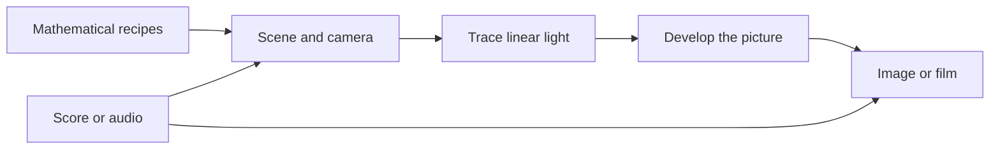

# Slayer

### Worlds made of mathematics. Pictures made of light.

Slayer is a Go renderer with procedural geometry, volumetric light,
astronomical scenes, a Metal backend for macOS, a photographic darkroom
and its own music synthesizer. You can make a small picture, build a
forest, light a fictional spacecraft or put a moving world to music.

**New here? [Make your first picture](../doc/getting-started.md).**
The [build guide](../doc/building.md) covers the required tools and source shelf.

> Models come from the manufactory: dimensions, profiles, branching rules
> and seeds. We generate the geometry with math. We do not build a world
> by importing a conventional asset collection.

## Choose a path

| You want to… | Start here |
|---|---|
| understand Slayer and make something small | [Getting started](../doc/getting-started.md) |
| get the tools and build | [Building Slayer](../doc/building.md) |
| understand the light in a picture | [How light works](../doc/light.md) |
| choose careful science or a fast film | [Rendering modes](../doc/modes.md) |
| understand the renderer's faster paths | [Optimizations](../doc/optimizations.md) |
| choose music or drive lights from a song | [Music](../doc/music.md) |
| make a new mathematical model | [Making models](../doc/making-models.md) |
| contribute code and test it | [Contributing](../CONTRIBUTING.md) · [Testing](../doc/testing.md) |
| understand render scheduling | [Azazel](../doc/azazel.md) |

## From a recipe to a film



A set describes the world. A job describes the photograph or film.
The renderer follows light; the darkroom chooses how it prints. A score
can supply sound alone or cue the scene's lights and motion.

## Two ways to see the manufactory

**The MCRN Larson** is a saucer made from revolved profiles, a glass shell,
angularly arranged portholes, material optics and programmed lights. Its
landed version adds shared stair geometry and a tripod. It is an authored
fictional design, not a claim of spacecraft engineering.

**Trees** combine seeded branching scaffolds and recursive shoots carrying
individual needles. Shared prototypes let a forest reuse geometry while
retaining real gaps for rays and light. Detail changes how a specimen is
represented, rather than turning every needle into an enormous scaled leaf.

[See how both are constructed →](../doc/making-models.md)

## Start small

After setup and a Game build, from the checkout root:

```sh
game run slayer -- assess doc/examples/jobs/first-picture.yaml
game run slayer -- draw doc/examples/jobs/first-picture.yaml
game run slayer -- draw doc/examples/jobs/first-film.yaml
```

The starter picture uses the CPU. The short film adds synthesized sound;
Slayer writes movies using AVFoundation on macOS with cgo. Larger scenes
have their own data and backend requirements.

## Explore further

[Renderer](../doc/renderer.md) · [Examples](../EXAMPLES.md) ·
[Package map](../PACKAGES.md) · [Job format](../job/README.md) ·
[Caches](../doc/caches.md) · [Project notes](../README.md)

For a problem report, include the build revision, exact command, job or
minimal scene, expected result and actual error. For a change, start with
the contribution guide and a focused test. You can work on one part of
Slayer without running every render in the repository.
