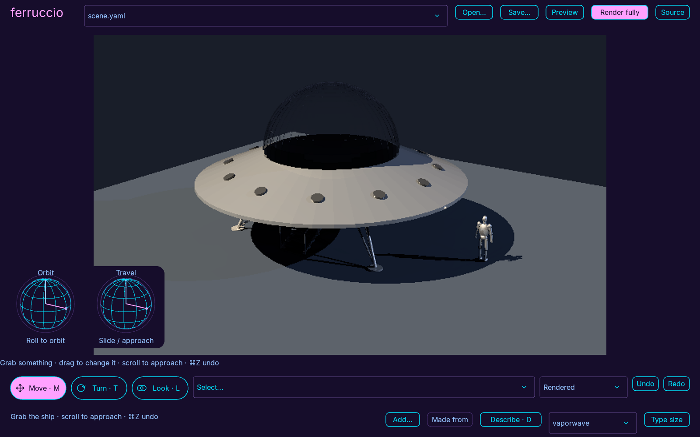
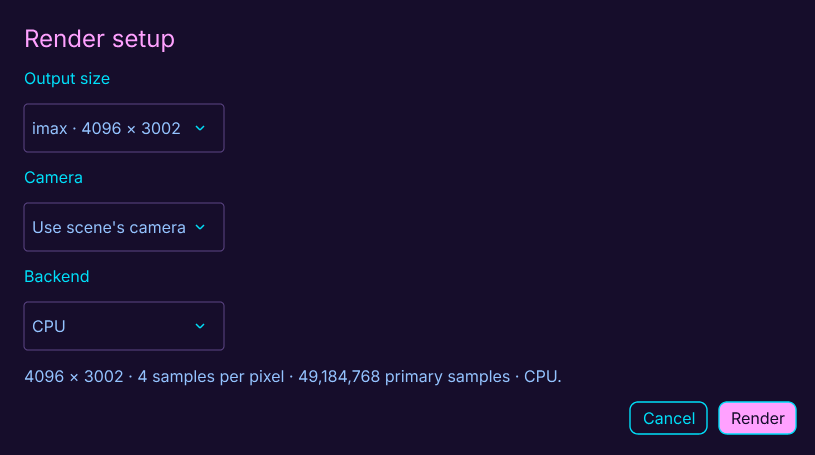

# Ferruccio quick start

Open a Slayer scene, move an object, and render your first image.

## Install and open a scene

On an Apple silicon Mac running macOS 13 or later, open the disk image and drag Ferruccio to Applications. If macOS blocks the first launch, see [howto-run-dis.md](howto-run-dis.md) beside the app on the disk image.

Ferruccio opens the **Larson playground** scene. Use the **Examples** menu beside **Open…** to choose **Larson camp**, with a two-metre person, a tree and a campfire, or **Oakland Larson study**, which includes an imported glTF model. To work on your own scene, choose **Open…** and select a Slayer set YAML file. A set describes the objects, lights, and cameras in a scene.

In Larson camp, the Larson is above the ground. The fire is separate from the campfire logs and does not appear in the working view; use **Source** to give `flame` the same east and north coordinates as `campfire` when moving it, and **Preview** to see the rendered scene.

## Make an edit

- Choose **Solid**, **Edges**, or **Wire** in the viewport menu, then click an object to select it. Choose **Move** or press **M**, then drag to reposition it. Choose **Turn** or press **T** and drag to rotate it.
- Choose **Look** or press **L** to inspect the scene. Scroll to approach, or use the **Orbit** and **Travel** controls to change the view.
- Press **Command-Z** to undo. Choose **Save** to keep your own YAML file. Ferruccio saves the imported models and their notices beside the YAML for Larson camp and the Oakland study. Use **Source** to inspect or edit the YAML.

## Preview and render

The installed app can set up its own render queue the first time you render. To use an existing Azazel queue, choose the folder containing **queue.db** in **Settings** → **Render queue**.

Choose **Preview** to check the scene. If an earlier image remains visible while a job runs, use the status in the app to see whether the new image is ready.

Choose **Render fully** to render at your chosen output size. In **Render setup**, review the size, camera, and backend before choosing **Render**. Start with a modest output size while framing or placing objects.

**Destination** shows the folder that will receive this render's image and
receipt in their own subfolder. Use **Choose…** to change it for this still.

When the new image arrives, select **Rendered** in the viewport menu to inspect it. Choose **Show in Finder** below the image to select its PNG, with `receipt.json` in the same folder. **Settings** → **Render output** shows where Ferruccio puts new render folders.
