# how to operate spacecraft in slayer


this is a guide to putting a spacecraft in a picture, and then in a film, and
then to how slayer makes the spacecraft in the first place. it has two parts.

part one uses only YAML. you write a small file, name a spacecraft, say where
the sun is, and draw it. every picture on this page was drawn by slayer from
the files beside this page, at 2k (2048 by 1152) except the film's frames,
which are 1280 by 720. nothing in part one needs you to read or write Go.

part two is for the reader who wants to make a spacecraft that isn't there
yet. it walks through the real code in `manufacture/`, with the file and line
beside every quoted piece.

the page is written to be read in order. each step is a whole file you can
draw on its own.

contents:

1. [before you start](#before-you-start)
2. [part one: spacecraft in YAML](#part-one-spacecraft-in-yaml)
   - [step 1: which spacecraft there are](#step-1-which-spacecraft-there-are)
   - [step 2: one spacecraft, alone](#step-2-one-spacecraft-alone)
   - [step 3: turning it](#step-3-turning-it)
   - [step 4: attached, and apart](#step-4-attached-and-apart)
   - [step 5: light that tells the truth](#step-5-light-that-tells-the-truth)
   - [step 6: a planet behind it](#step-6-a-planet-behind-it)
   - [step 7: a camera that moves round it](#step-7-a-camera-that-moves-round-it)
   - [step 8: two craft in one scene](#step-8-two-craft-in-one-scene)
   - [what the sets can't say yet](#what-the-sets-cant-say-yet)
3. [part two: how a spacecraft is made](#part-two-how-a-spacecraft-is-made)

## before you start

you need the checkout built, as the [visual guide](../../../visualguide/README.md)
describes: `bin/slayer` exists, Game and ffmpeg are on your path, and the
shelf is set. these spacecraft read no terrain and no dataset from the shelf,
so the shelf matters here only because the build checks it.

one more thing a draw wants, if you haven't set it: a folder for what slayer
can work out again. name an absolute path, in your shell:

```sh
export GOWORK=off
export SLAYER_CACHE="$HOME/slayer/cache"
mkdir -p "$SLAYER_CACHE"
```

every command below runs from the checkout root. the sets are in
`doc/model/spacecraft/guide/sets/` and the jobs in `doc/model/spacecraft/guide/jobs/`.
each job names its set, and writes its picture into
`doc/model/spacecraft/guide/images/`. output paths in a job are relative to the job
file, as they are in the visual guide.

a set describes the world, and a job describes the photograph. this page uses
both, the way the visual guide does.

> **today's state.** the pictures here were drawn from the `rc-v0.1.4` line,
> where the new spacecraft are. a few of the things this page would like to
> use aren't drawn yet, and [the last section of part one](#what-the-sets-cant-say-yet)
> says which, by the name the reader gives them.

## part one: spacecraft in YAML

### step 1: which spacecraft there are

slayer makes a spacecraft the way it makes a tree: from a **kind**, a name,
and a seed. you ask the front door what kinds there are:

```sh
bin/slayer list kinds
```

it prints every kind the manufactory makes, each with the details it can be
made at. the spacecraft among them, as of `rc-v0.1.4`:

- **new in 0.1.4:** `voyager-1` and `voyager-2`, `soho`, `jimo`, `cassini`,
  `huygens`, `cassini-huygens`, `mariner-10`, `new-horizons`,
  `new-horizons-vtad`, and `prima`.
- **already in 0.1.3:** `spitzer`, `hubble`, `webb`, `apollo-csm`,
  `apollo-lunar-module`, `soyuz-ms`, `mercury-capsule`, `gemini`, `saturn-v`,
  `saturn-v-apollo`, `saturn-ib`, `sls-block-1` and `venera-lander`.

every one is made at four details, `hull`, `clumps`, `quick` and `demo`, from
a bare silhouette to the most that kind has. step 2 says where you choose.

here is a row of eight of them in one set, side by side in the sun. left to
right, front row, then back row: Voyager 1, SOHO, Mariner 10, New Horizons;
JIMO, Cassini with Huygens attached, prima, and Webb.

`doc/model/spacecraft/guide/sets/step-1-lineup.yaml`

```yaml
"$schema": https://github.com/janearc/slayer/schemas/ecosystem-v2.json
scene:
  name: step 1, eight spacecraft side by side
  seed: 17
  setting: space
  light: sun
  sun: {azimuth: 225, altitude: 28}
  set:
    things:
      # the front row, left to right
      voyager-1: {kind: voyager-1, seed: 17, complexity: quick, east: -48, north: 0, height: {value: 0, unit: m}}
      soho: {kind: soho, seed: 17, complexity: quick, east: -16, north: 0}
      mariner-10: {kind: mariner-10, seed: 17, complexity: quick, east: 16, north: 0}
      new-horizons: {kind: new-horizons, seed: 17, complexity: quick, east: 48, north: 0}
      # the back row
      jimo: {kind: jimo, seed: 17, complexity: quick, east: -48, north: 45}
      cassini: {kind: cassini-huygens, seed: 17, complexity: quick, east: -16, north: 45}
      prima: {kind: prima, seed: 17, complexity: quick, east: 16, north: 45}
      webb: {kind: webb, seed: 17, complexity: quick, east: 48, north: 45}
  film: {width: 2048, height: 1152, rays: 2, exposure: 0.004, wide: 52}
  cameras:
    lineup:
      title: the two rows, from the sun's side
      location: {at: [0, -130, 45]}
      orientation: {look_at: [0, 22, 10]}
  world:
    unit: 1
    sky:
      stars: {seed: 29, share: 0.01, size: 0.3, bright: 0.6}
      source: eye
```

```sh
bin/slayer draw doc/model/spacecraft/guide/jobs/step-1-lineup.yaml
```

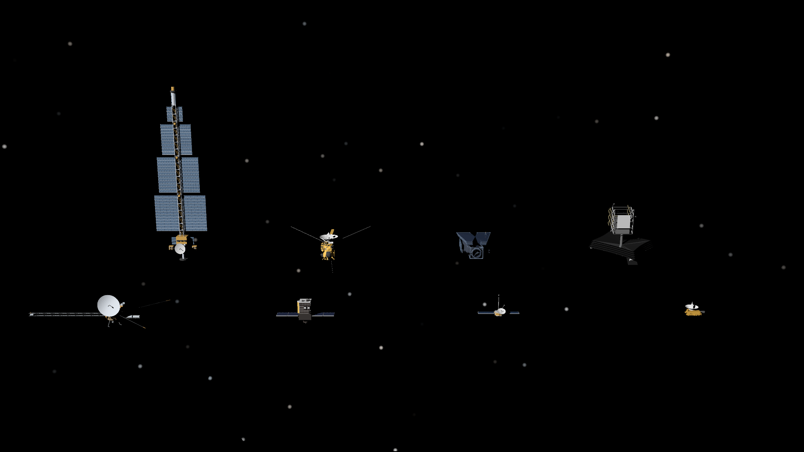

*step 1. eight spacecraft in one set. each is drawn at its real size in
metres, so JIMO, at about 39 m, is the tall one and New Horizons, at about
4 m, is the small gold one at the right of the front row.*

the file shows the shape of every set in this guide. `setting: space` says
there is no ground and no air. `light: sun` with a `sun` says where the lamp
is. each thing under `things` has a `kind`, a `seed`, a `complexity`, and a
place in metres: `east` and `north` across the scene, and `height` up. the
camera stands at `at` and looks at `look_at`, and both are `[east, north, up]`
in metres.

#### what is sourced and what is picked

every kind says in `cmd/catalogue/menu.yaml` what it is built from. here are
the notes it keeps for the new craft, in its own words:

- **Voyager 1 and 2:** "NASA supplies the primary dimensions. Minor fittings
  and finishes are visual estimates shared by the two spacecraft."
- **SOHO:** "ESA overall scale with photo-led flight fittings and estimated
  surface treatments."
- **JIMO:** "Unflown NASA concept with visually estimated dimensions and
  finishes." it is the 2012 concept, not a flown craft.
- **Cassini, Huygens, and Cassini with Huygens:** "NASA mesh adapted for the
  renderer. Material assignments are simplified."
- **Mariner 10:** "NASA bus, array span and reflector sizes with estimated
  minor fittings."
- **New Horizons:** "NASA printable meshes with an estimated assembly and
  flat materials."

slayer also counts the numbers each kind reads, as **measured** (it has a
pinned source, held to the source's own text) or **picked** (somebody chose it,
and the record says who). a maturity report made from this checkout on
17 november 2026 gave:

| kind | parts | measured | picked | size at quick, metres (across, up, deep) |
| --- | ---: | ---: | ---: | --- |
| `voyager-1`, `voyager-2` | 290 | 6 | 13 | 21.6, 5.9, 14.8 |
| `prima` | 127 | 1 | 115 | 8.3, 9.9, 9.9 |
| `webb` | 90 | 7 | 62 | 14.2, 11.6, 21.2 |
| `spitzer` | 831 | 7 | 31 | 4.1, 4.9, 2.6 |
| `hubble` | 55 | 1 | 37 | 12.0, 16.1, 3.7 |
| `soho` | 614 | 0 | 0 | 9.5, 4.7, 4.3 |
| `mariner-10` | 636 | 0 | 0 | 6.8, 4.2, 5.8 |
| `jimo` | 1503 | 0 | 0 | 11.6, 39.0, 6.5 |
| `cassini-huygens` | 10 | 0 | 0 | 20.0, 13.0, 15.0 |
| `new-horizons` | 3 | 0 | 0 | 4.5, 3.3, 2.6 |

read the zeros with care. a zero does not mean nothing in SOHO is measured:
SOHO's 4.3 m and 9.5 m come from ESA and are written into the code with a
comment, not into a book of named numbers, and the report counts only the
named ones. it counts what it can see, and says so. part two shows where the
two kinds of number live. the whole table, with every spacecraft kind and the
detail each is made at, is in [maturity-2026-11-17.txt](maturity-2026-11-17.txt).

> **today's state.** `catalogue list` and `catalogue inventory` print these
> numbers and the references for every kind, and the catalogue book draws a
> card for each. at this tip they stop before printing: the menu names
> `alfa-hero` twice and has no entry for `prima`. `slayer list kinds` works,
> and the table above was made by calling the maturity report directly.

### step 2: one spacecraft, alone

the smallest scene that's a spacecraft: one kind, black sky, the sun as a
lamp, and some stars behind.

`doc/model/spacecraft/guide/sets/step-2-alone.yaml`

```yaml
"$schema": https://github.com/janearc/slayer/schemas/ecosystem-v2.json
scene:
  name: step 2, Voyager 1 alone in space
  seed: 17
  setting: space
  light: sun
  sun: {azimuth: 225, altitude: 28}
  set:
    things:
      voyager-1:
        kind: voyager-1
        seed: 17
        complexity: demo
        east: 0
        north: 0
  film:
    width: 2048
    height: 1152
    rays: 2
    exposure: 0.003
    wide: 45
  cameras:
    three-quarter:
      title: Voyager 1 from the sunlit side
      location: {at: [-30, -22, 16]}
      orientation: {look_at: [-5, 0, 0]}
  world:
    unit: 1
    sky:
      stars: {seed: 29, share: 0.01, size: 0.3, bright: 0.6}
      source: eye
```

`doc/model/spacecraft/guide/jobs/step-2-alone.yaml`

```yaml
"$schema": https://github.com/janearc/slayer/schemas/job-v1.json
scene: {set: ../sets/step-2-alone.yaml}
renderer: gpu-native
film: {preset: 2k, rays: 2}
camera: {name: three-quarter}
outputs:
  picture: ../images/step-2-alone.png
```

```sh
bin/slayer draw doc/model/spacecraft/guide/jobs/step-2-alone.yaml
```

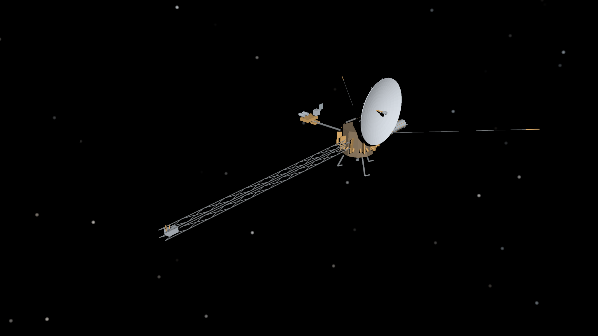

*step 2. Voyager 1 from the sunlit side.*

`complexity: demo` is the most detail the kind has. `quick`, the default, is
what step 1 used.

the sun is `sun: {azimuth: 225, altitude: 28}`. azimuth is degrees clockwise
from north, and altitude is degrees up, so this lamp is to the south-west and
a little above. it is one distant lamp, as bright as sunlight at the earth.
that is a real number, 1361 watts a square metre, and it is the one thing in
the light that is. the camera stands on the same side, so the side you see is
the lit side.

`exposure: 0.003` is the picture's brightness. at the earth's distance the
sun is very bright, and a small exposure keeps white paint from burning out.
the file used `0.01` first, and the dish went to flat white.

the sky is black, as it is in space, because the set says nothing else. the
stars come from the `world` half: `stars` makes a field of points from a
`seed`. `share` is how much of the sky holds one, `size` and `bright` are how
they look. they are a made field, not the real sky. [what the sets can't say yet](#what-the-sets-cant-say-yet)
says where the real one stands.

every number in `stars` is picked, and `source: eye` says so. a set has to
say where each of its numbers came from, and `eye` means judged by eye.

a camera's `look_at` and `at` are both in metres from the scene's middle.
Voyager's long boom runs one way and its dish stands up the other, so the
camera is a long way off to the south-west, a little above.

### step 3: turning it

a thing turns about the vertical by its `heading`, in degrees clockwise from
north. here are three copies of Voyager 1 with three headings. only the things
block and the camera change from step 2.

`doc/model/spacecraft/guide/sets/step-3-turned.yaml`, the things:

```yaml
  set:
    things:
      heading-0:
        kind: voyager-1
        seed: 17
        complexity: quick
        east: -26
        north: 0
        heading: {value: 0, unit: deg}
      heading-90:
        kind: voyager-1
        seed: 17
        complexity: quick
        east: 0
        north: 0
        heading: {value: 90, unit: deg}
      heading-180:
        kind: voyager-1
        seed: 17
        complexity: quick
        east: 26
        north: 0
        heading: {value: 180, unit: deg}
```

```sh
bin/slayer draw doc/model/spacecraft/guide/jobs/step-3-turned.yaml
```


*step 3. headings of 0, 90 and 180 degrees, left to right.*

the heading turns each thing about its own up. it can't tip a thing, or point
a dish at a place on the sky. the set file has a key for that, `attitude`,
which says which way a thing points: "nadir" (straight down), a place on the
sky by right ascension and declination, or another thing, and which side faces
the sun. slayer reads the key and checks it. it does not draw it yet, and says
so by name:

```text
thing.attitude is read and not yet drawn
```

so to look at a spacecraft from another side, there are two ways that work
today: turn the thing with `heading`, or move the camera. step 7 moves the
camera.

### step 4: attached, and apart

some kinds come both ways. Cassini has three:

- `cassini`, the orbiter alone;
- `huygens`, the Titan entry capsule alone;
- `cassini-huygens`, the orbiter with Huygens in its attached cruise position.

all three come from the same NASA mesh, adapted for the renderer, with
simplified materials. here is the attached one:

`doc/model/spacecraft/guide/sets/step-4-attached.yaml`, the things:

```yaml
  set:
    things:
      orbiter:
        kind: cassini-huygens
        seed: 17
        complexity: demo
        east: 0
        north: 0
```

```sh
bin/slayer draw doc/model/spacecraft/guide/jobs/step-4-attached.yaml
```

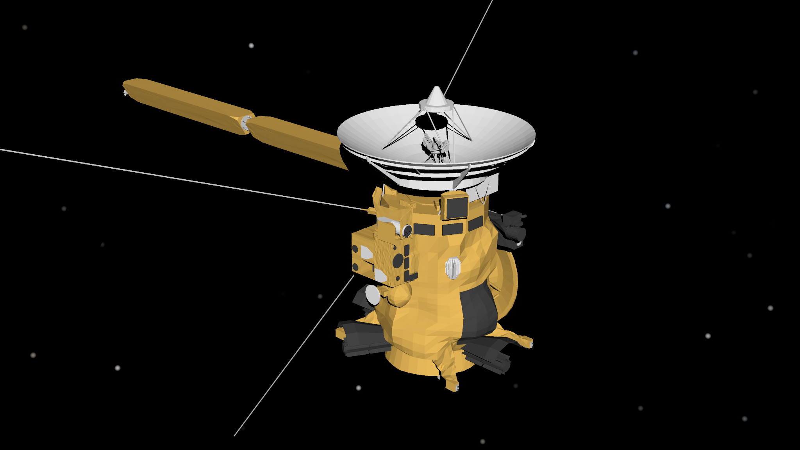

*step 4. Cassini with Huygens attached.*

Voyager 1 and 2 are a different case. their kinds are deployed spacecraft:
the dish, the instrument booms, the generator boom and the antennas are all
out, and there is no stowed Voyager. the deployed view in the hero set is the
same model seen from further off. if you want a craft folded up for launch, it
isn't there.

### step 5: light that tells the truth

a mirror shows what it faces. Webb's primary mirror in slayer is made of
segments with the optical constants of gold, so it reflects. in space, a
mirror that faces black space reflects black. that is the right answer, and
the picture comes out dark.

`doc/model/spacecraft/guide/sets/step-5a-webb-black.yaml`, the sky:

```yaml
  world:
    unit: 1
    sky:
      horizon: {srgb_linear: [0, 0, 0]}
      zenith: {srgb_linear: [0, 0, 0]}
      ground: {srgb_linear: [0, 0, 0]}
      source: eye
```

```sh
bin/slayer draw doc/model/spacecraft/guide/jobs/step-5a-webb-black.yaml
```

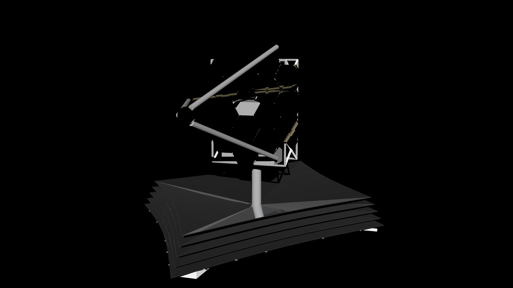

*step 5a. the mirror reflects black space, so it is black.* the sun lights the
booms and the shield, and the mirror shows what is in front of it: nothing.

to give the mirror something to reflect, give the world a sky that isn't
black. this is a studio cheat. real space has no sky of this kind, and the
set says so by naming it a sky and nothing else:

`doc/model/spacecraft/guide/sets/step-5b-webb-lit-sky.yaml`, the sky:

```yaml
  world:
    unit: 1
    sky:
      horizon: {srgb_linear: [0.6, 0.55, 0.45]}
      zenith: {srgb_linear: [0.35, 0.4, 0.55]}
      ground: {srgb_linear: [0.4, 0.4, 0.42]}
      source: eye
```

```sh
bin/slayer draw doc/model/spacecraft/guide/jobs/step-5b-webb-lit-sky.yaml
```

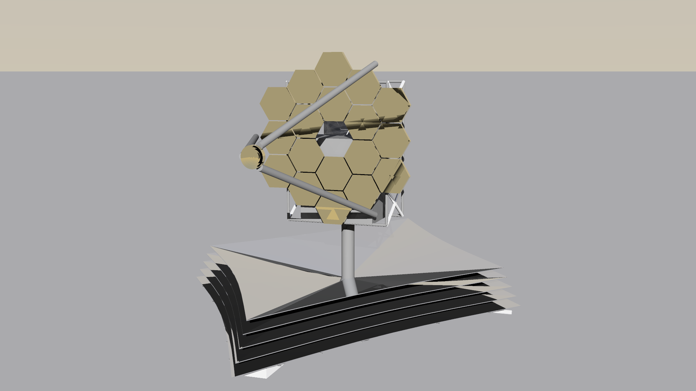

*step 5b. the same Webb in front of a lit sky: the segments turn gold.*

the sky's `horizon`, `zenith` and `ground` are colours in linear light, and
the mirror reflects them. the numbers are picked by eye.

there is a second way, which is what `sets/webb-at-l2.yaml` does: put a lamp
where the mirror can see it. that set has the MCRN Larson hovering in
Webb's shade, and the Larson's belly lamp is what lights the mirror. it is the
nearer thing to a real light, and it is also dark, because the lamp is small.

### step 6: a planet behind it

this is the scene to copy. it's a spacecraft with Saturn in the background.
it is not meant to be realistic. it is something to look at.

a set may hang a **body** in its `world`, from a template. `saturn` is one of
them: slayer's own Saturn, with its bands and its rings, drawn from the
template's numbers. you place it with `middle` and size it with `radius`, both
in the scene's metres.

`doc/model/spacecraft/guide/sets/step-6-saturn.yaml`

```yaml
"$schema": https://github.com/janearc/slayer/schemas/ecosystem-v2.json
scene:
  name: step 6, Cassini with Saturn behind it
  seed: 17
  setting: space
  light: sun
  sun: {azimuth: 225, altitude: 28}
  set:
    things:
      orbiter:
        kind: cassini
        seed: 17
        complexity: demo
        east: 0
        north: 0
  film: {width: 2048, height: 1152, rays: 2, exposure: 0.003, wide: 50}
  cameras:
    toward-saturn:
      title: Cassini, with Saturn behind
      location: {at: [-22, -19, 8]}
      orientation: {look_at: [0, 1, 0]}
  world:
    unit: 1
    sky:
      stars: {seed: 29, share: 0.01, size: 0.3, bright: 0.6}
      source: eye
    bodies:
      saturn:
        template: saturn
        middle: [520000000, 400000000, -80000000]
        radius: 60268000
        detail: 3
```

`doc/model/spacecraft/guide/jobs/step-6-saturn.yaml`

```yaml
"$schema": https://github.com/janearc/slayer/schemas/job-v1.json
scene: {set: ../sets/step-6-saturn.yaml}
renderer: gpu-native
film: {preset: 2k, rays: 2}
camera: {name: toward-saturn}
outputs:
  picture: ../images/step-6-saturn.png
```

```sh
bin/slayer draw doc/model/spacecraft/guide/jobs/step-6-saturn.yaml
```


*step 6. Cassini, with Saturn behind.*

Saturn's radius is 60,268,000 m, its equatorial radius, and it stands about
660 million metres from the middle of the scene, eleven of its own radii. the
distance, the direction and the lean are picked to make a picture, and are not
Cassini's orbit. the sun is the same lamp as every other step, behind the
camera, so you see Saturn's lit face.

what is real here: the planet's size, and the structure of its rings, which is
the template's. a twelve-point profile of the rings from the inner edge of the
C ring to the outer edge of the A ring, with the Cassini division between.

what isn't: the template says in its own comments that the encke gap and the
narrow ringlets are too fine for twelve samples, that the D, E, F and G rings
are left out, and that its figures are from memory. the edge of the rings is
ragged at this size for the same reason.

the other templates a body can wear are `charon`, `earth`, `hale-bopp`,
`hot-jupiter`, `hyakutake`, `jupiter`, `magnetar`, `mars`, `mercury`,
`neptune`, `pluto`, `pulsar`, `quasar`, `sol`, `uranus` and `venus`.

> **today's state.** slayer has a second set of ring numbers, the profiles
> made from occultation measurements, in the `occultation` package. no key in a
> set reaches them yet, so this scene uses the template's rings and says so.
> the `planet` block of a set, which does take rings, is refused in a scene in
> space.

### step 7: a camera that moves round it

this one is a job, not a set. it names the step 6 set, sizes the frames, and
gives the camera a path round Cassini. it is the same shape as the visual
guide's step 7, and the points mean the same: x east, y up and z south, in
metres from the scene's middle.

`doc/model/spacecraft/guide/jobs/step-7-orbit-film.yaml`

```yaml
"$schema": https://github.com/janearc/slayer/schemas/job-v1.json
scene: {set: ../sets/step-6-saturn.yaml}
renderer: gpu-native
film: {preset: 720, rays: 2}
fps: 4
duration: {value: 2, unit: s}
camera:
  unit: m
  look-at: {x: 0, y: 1, z: 0}
  moves:
    - from: {x: 0, y: 9, z: 30}
      to: {x: -21, y: 9, z: 21}
      duration: {value: 1, unit: s}
    - from: {x: -21, y: 9, z: 21}
      to: {x: -30, y: 9, z: 0}
      duration: {value: 1, unit: s}
outputs:
  frames: ../images/step-7-frames
  movie: ../images/step-7-orbit.mp4
```

```sh
bin/slayer draw doc/model/spacecraft/guide/jobs/step-7-orbit-film.yaml
```

it draws eight frames at 1280 by 720, two seconds at four frames a second, and
joins them into `images/step-7-orbit.mp4`. each move is a straight line, so a
curve is several moves. here the camera starts to the south of Cassini,
swings to the south-west and on to the west, and always looks at Cassini's
middle. as it comes round, Saturn slides in from the left.

[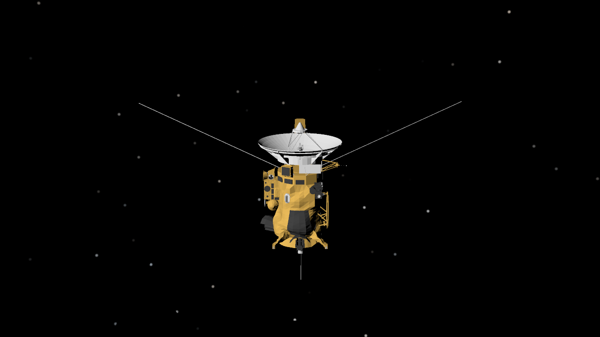](images/step-7-orbit.mp4)

the first frame of the film, linked to [step-7-orbit.mp4](images/step-7-orbit.mp4).
GitHub doesn't play video from a page, so open the file.


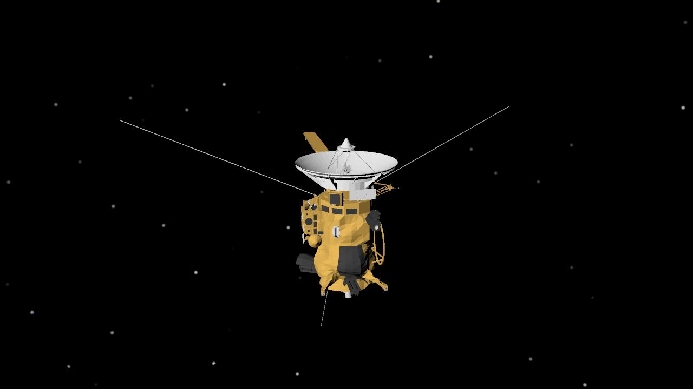
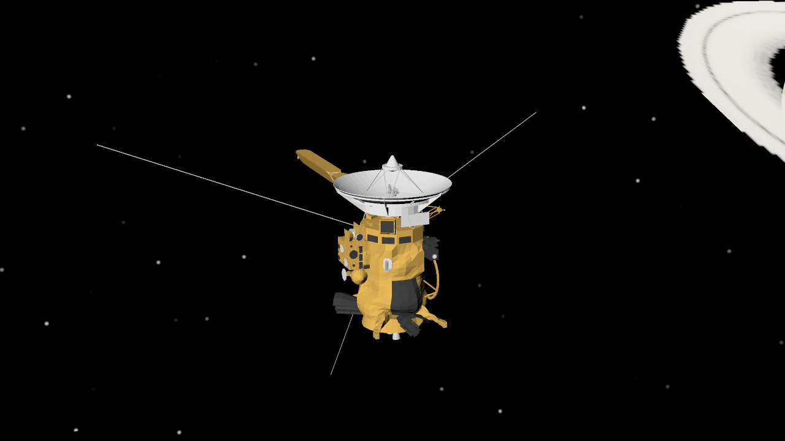
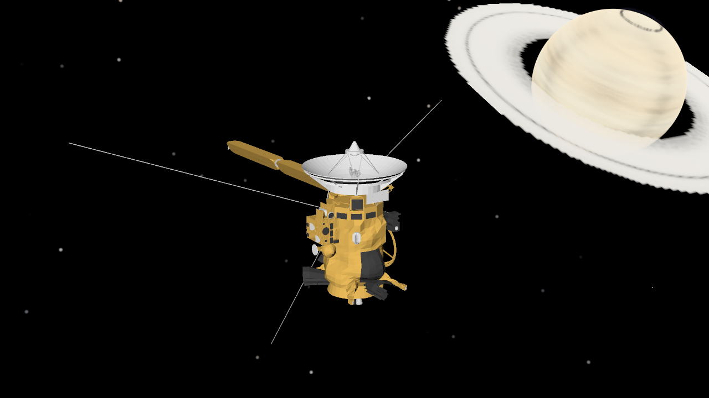

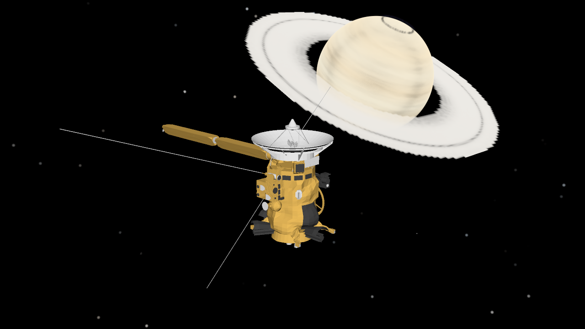
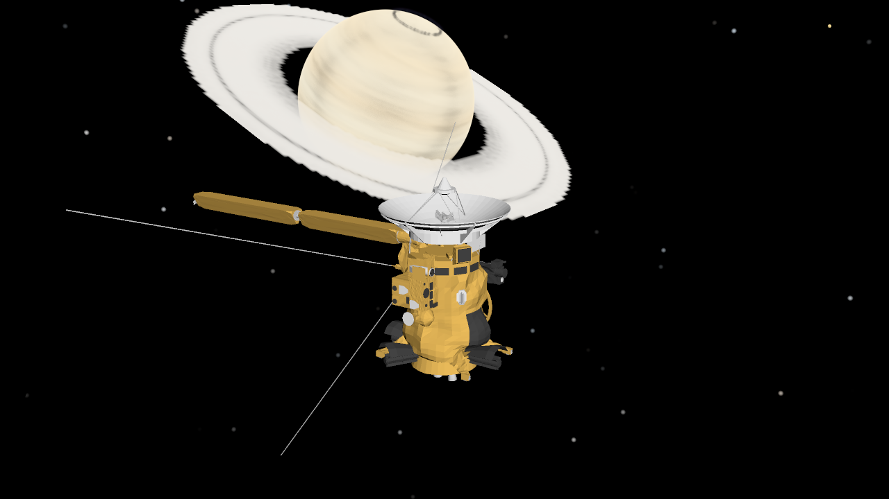
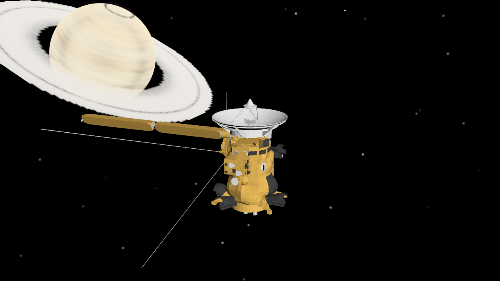
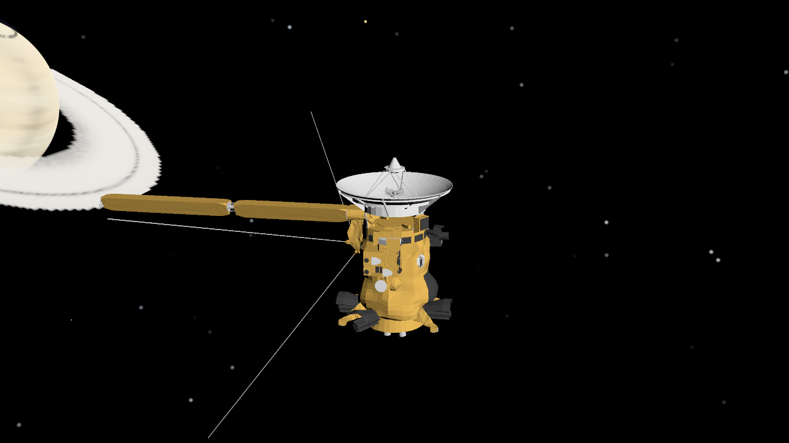

*the eight frames of step 7, left to right, top to bottom.*

the frames land in `images/step-7-frames/`. to draw frames that slayer already
holds again, add `--fresh`.

### step 8: two craft in one scene

Cassini and Huygens, apart. two things in one set, each with its own kind and
its own place. Huygens is 14 m to the east of Cassini and 6 m up, as if just
released.

`doc/model/spacecraft/guide/sets/step-8-released.yaml`, the things:

```yaml
  set:
    things:
      orbiter:
        kind: cassini
        seed: 17
        complexity: demo
        east: 0
        north: 0
      probe:
        kind: huygens
        seed: 17
        complexity: demo
        east: 14
        north: 0
        height: {value: 6, unit: m}
  film: {width: 2048, height: 1152, rays: 2, exposure: 0.003, wide: 45}
```

```sh
bin/slayer draw doc/model/spacecraft/guide/jobs/step-8-released.yaml
```

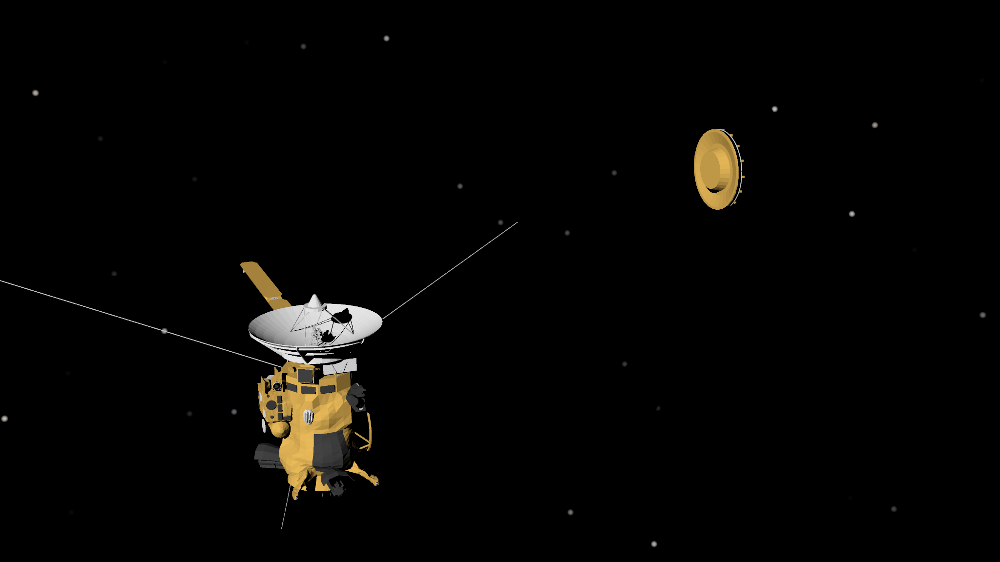

*step 8. Cassini, and Huygens a little way off.*

each thing keeps its own seed, so they are made separately, and the kinds
know nothing about each other. the distance is yours to choose, and it is a
choice: the set doesn't move Huygens along a path or spin it. a thing in a
set stays where it is put, in a still. step 7 moves the camera. no key that moves a thing along a path is drawn yet. the nearest thing to motion is `part-spin`, in
[doc/model/spacecraft/part-spin.md](../part-spin.md), turns one material of a craft about an
axis, and is the nearest thing to motion a craft has.

### what the sets can't say yet

these things the path above would have used, and the readers don't take them
yet. none is faked in the pictures.

- **the real sky.** `scene.sky` takes a catalogue of stars (`from: gaia`, a
  place on the sky, a radius and a faintest magnitude). the reader keeps it
  and the stage refuses it: "scene.sky is read and not yet drawn". the stars
  in these pictures are `world.sky.stars`, a made field.
- **a spacecraft's attitude.** `thing.attitude` is read and not yet drawn, as
  step 3 says. only `heading`, about the vertical, turns a thing.
- **a planet block with rings, in space.** the scene's `planet` block is
  refused in a scene in space, so the planet is a world body, and its rings are
  the template's.
- **a stowed Voyager.** only the deployed one is made.
- **the Earth as a mirror's view.** an `earth` body draws on its own, and Webb
  could reflect it. when the first tries here put one in Webb's scene, Webb
  stopped drawing, and the cause was not found, so step 5 uses a sky.
- **the date, the frame, an anchor, an orbit, a camera's moves in a set.** all
  are named in the schema, and a set that says one is refused by name. a
  camera path is the job's (step 7).

## part two: how a spacecraft is made

this part is for someone who will write a kind. it describes the code as it
is on `rc-v0.1.4`, and quotes it with the file and line, so you can open the
file beside it. nothing here proposes a change.

a spacecraft here is a **kind**: a name, and a way to make one from a seed. the
manufactory, package `manufacture`, holds a table of every kind. a caller asks
for a kind by name, and the same name and seed make the same thing every time.

the example is `voyager-1`, with `soho` and `webb` where they show something
different. Voyager is a good one because the commit that added it is a
complete list of what a new kind touches, and it is short enough to read.

### how a kind is registered

a kind is a row in a table. a row is anything that can say how to make one:

`manufacture/kinds.go:81-92`

```go
// maker is what a row knows: how to make one of its kind from a seed.
type maker interface {
	made(from seed) (good, error)
}

// kind is a row of the table: a name, and how one is made.
//
// found only by kindNamed.
type kind struct {
	name string
	how  maker
}
```

`maker` has one method. `kind` is a name and a maker. the table is a map from
name to maker, built by `table()`:

`manufacture/kinds.go:103-113`

```go
	rows["guide-star-launcher"] = guideLauncher{}
	rows["soho"] = soho{}
	rows["cassini"] = cassiniHuygens{}
	rows["huygens"] = cassiniHuygens{probe: true}
	rows["cassini-huygens"] = cassiniHuygens{attached: true}
	rows["new-horizons"] = newHorizons{}
	rows["new-horizons-vtad"] = newHorizonsVTAD{}
	rows["saguaro"] = saguaro{}
	rows["human-scale-2m"] = scaleHuman{}
	rows["mariner-10"] = mariner10{}
	rows["jimo"] = jimo{}
```

single kinds are put in by hand, one line each. kinds that come in families
are put in by a function that returns a map of them, and a loop copies it in:

`manufacture/kinds.go:128-133`

```go
	for name, row := range spacecraftRows() {
		rows[name] = row
	}
	for name, row := range voyagerRows() {
		rows[name] = row
	}
```

Voyager's two kinds are one function, `voyagerRows`, giving both names the one
maker:

`manufacture/voyager.go:24-29`

```go
func voyagerRows() map[string]maker {
	return map[string]maker{
		"voyager-1": voyagerMaker{},
		"voyager-2": voyagerMaker{},
	}
}
```

the two probes are identical hardware, so the two names share one assembly.
the separate names exist so a set can say which probe it means. SOHO is
registered by hand, on a line of its own (`kinds.go:104`).

`kindNamed` is how everything finds a kind, and a name that isn't in the table
is refused with a list of the ones that are (`manufacture/kinds.go:202`).

### how parts are built and assembled

a spacecraft is built from **parts**, each a closed solid with a material, put
together in an `instrumentAssembly`:

`manufacture/instrument_assembly.go:10-23`

```go
type instrumentAssembly struct {
	object  good
	fine    cut
	trouble error
}

// add retains a part in its own frame and material slot.
func (assembly *instrumentAssembly) add(shape form,
	space maths.Subspace, material slot,
) {
	assembly.object.parts = append(assembly.object.parts,
		part{shape: shape, space: space,
			fine: assembly.fine, of: material})
}
```

`add` puts any shape in place in a pose. `box` and `rod` are helpers on top of it: a box from its corner, and a tube between two points. this is `rod`:

`manufacture/instrument_assembly.go:41-46`

```go
// rod aligns a checked tube between explicit endpoints.
func (assembly *instrumentAssembly) rod(from, to maths.Vec,
	radius float64, material slot,
) {
	assembly.rodAlong(from, to.Sub(from), radius, material)
}
```

`finish` returns the object, and takes the bounds the kind declares, or the
first error any part had:

`manufacture/instrument_assembly.go:72-79`

```go
// finish returns no object when any component construction failed.
func (assembly *instrumentAssembly) finish(bounds maths.Box) (*good, error) {
	if assembly.trouble != nil {
		return nil, assembly.trouble
	}
	assembly.object.extent = &bounds
	return &assembly.object, nil
}
```

a kind's `made` function makes an assembly and calls its own helper for each
subsystem. this is Voyager's, at the point it assembles the booms and dish:

`manufacture/voyager.go:48-63`

```go
	assembly := &instrumentAssembly{
		fine:   cut{around: around},
		object: good{dressed: voyagerLooks()},
	}
	voyagerMaker{}.bus(assembly)
	voyagerMaker{}.highGainAntenna(assembly)
	voyagerMaker{}.magnetometerBoom(assembly)
	voyagerMaker{}.radioAntennae(assembly)
	voyagerMaker{}.rtgBoom(assembly)
	voyagerMaker{}.scienceBoom(assembly)
	voyagerMaker{}.thrusters(assembly)
	object, err := assembly.finish(voyagerBounds())
	if err != nil {
		return good{}, err
	}
	return *object, nil
```

`bus`, `highGainAntenna` and the rest are methods on the maker, one for each
physical subsystem. the bus begins with a measured diameter and a picked
height, and turns a profile about the axis into a ten-sided body:

`manufacture/voyager.go:89-99`

```go
func (voyagerMaker) bus(assembly *instrumentAssembly) {
	diameter := research.Value("voyager-bus-diameter-metres")
	radius := diameter * spaceHalf
	height := 1.5 // picked bus height; only its diameter is measured
	previous := assembly.fine
	assembly.fine.around = voyagerBusSides
	assembly.add(turnedProfile{points: [][coordinatePair]float64{
		{0, -height * spaceHalf}, {radius, -height * spaceHalf},
		{radius, height * spaceHalf}, {0, height * spaceHalf},
	}}, maths.Local(), body)
	assembly.fine = previous
```

the ten sides are from NASA's description of the electronics bus, and the
code says so in a comment (`voyager.go:11`). the `1.5` is picked, and the
comment beside it says that only the diameter is measured.

a part is made of any form the manufactory has: a box, a tube, a turned
profile, a dish (`radioDish`, `mirrorDish`). a spacecraft with a huge number
of parts has to keep each part's tessellation, the number of sides round a
round part, down. Voyager caps its sides at 48 for that reason, and says why:

`manufacture/voyager.go:42-47`

```go
	around := int(spacecraftValue("sides-" + detail))
	// This assembly has many capped struts. Keep their shared tessellation
	// within Things' 100k-face flattening limit even at demo complexity.
	if around > 48 {
		around = 48
	}
```

some kinds don't build their parts in code. Cassini, Huygens and New Horizons carry NASA meshes, embedded in the program as binary STL files. each file becomes a part whose shape reads its triangles, and the same assembly then places it:

`manufacture/cassini_huygens.go:16-17`

```go
// approximately 4 m. The added rim and fittings are image-led estimates.
// https://www.esa.int/Science_Exploration/Space_Science/Cassini-Huygens/Huygens_spacecraft
```

the report counts both kinds of part as parts and pieces.

### where the sourced numbers and the picked choices live

there are two books of named numbers, and one rule: a number that stands for
a real thing goes in the first, and a number somebody chose goes in the second.

**sourced numbers** live in `research/research-derived-data.yml`. each entry
names its source, by key in `sources.yaml`, and the place in it, and the text
printed there:

`research/research-derived-data.yml:1306-1315`

```text
  - name: voyager-bus-diameter-metres
    value: 1.8
    unit: m
    says: approximate bus housing electronics diameter
    kind: measured
    source:
      key: voyager-faq
      where: FAQ, How big is Voyager? How much does it weigh?, bus housing
      text: '1.8'
      excerpt: The Bus Housing Electronics is about 1.8 meters in diameter.
```

a kind reads it by name, and a name that isn't there stops the program:

`research/research.go:36-49`

```go
func Value(name string) float64 {
	read, err := values()
	if err != nil {
		panic(err)
	}
	number, err := read.Get(name)
	if err != nil {
		panic(fmt.Errorf("research: %w", err))
	}
	if see := observer.Load(); see != nil {
		(*see)(*number)
	}
	return number.Value
}
```

`sources.yaml` pins each source by file, hash and size, and `game run
sources-verify` holds every entry to the source's own text before a build
(`research/research-derived-data.yml:1-7`). for Voyager the source is the
NASA frequently asked questions page (`sources.yaml:1119`).

**picked choices** live in a book beside the code, `spacecraft-choices.yaml`,
embedded into the program:

`manufacture/spacecraft_data.go:9-27`

```go
//go:embed spacecraft-choices.yaml
var spacecraftChoices []byte

var spacecraftNumbers, spacecraftNumbersError = numbers.Read(
	"spacecraft-choices.yaml", spacecraftChoices)

// spacecraftValue reads immutable authored geometry and appearance choices.
func spacecraftValue(name string) float64 {
	if spacecraftNumbersError != nil {
		panic(spacecraftNumbersError)
	}
	value, err := spacecraftNumbers.Get(name)
	if err != nil {
		panic(err)
	}
	noted(value)
	return value.Value
}
```

each entry says what it is, that it is `picked`, and by whom and when:

`manufacture/spacecraft-choices.yaml:19-23`

```text
- name: sides-hull
  value: 12
  says: enclosure tessellation at hull detail
  kind: picked
  by: Slayer's spacecraft templates, 2026-11-07
```

`spacecraftValue` is the one door to it, and every read is reported to
`noted`.

**what the maturity report counts.** `MaturityReport` makes every kind once at
every detail, and watches every read of those two books while it does (`research.Observe` for the sourced one, `manufacture/maturity.go:79`; `noted` for the picked one). the
reads are filed under the kind being made:

`manufacture/maturity.go:176-193`

```go
// noted tells a running report that a book of choices gave out a number.
func noted(number *numbers.Number) {
	if book := watching.Load(); book != nil {
		book.add(*number)
	}
}

// rowOf builds a row and, while a report runs, counts the numbers the
// building reads for the kinds named. A row that reads measured numbers
// as the table is built says whose they are by building itself here.
func rowOf[row maker](build func() row, kinds ...string) row {
	book := watching.Load()
	if book == nil {
		return build()
	}
	defer book.scope(book.scope(kinds))
	return build()
}
```

so a number a kind reads while it is made is counted for that kind, measured or
picked by the `kind:` field of its entry. a row that reads numbers when the
table is built, as Webb's aperture is, says whose they are by building itself
inside `rowOf`, named for its kinds (`manufacture/spacecraft.go:100`).

what the report cannot count: a number written straight into the code, as the
bus height `1.5` in `voyager.go:92` and all of SOHO's boxes, is not in a book
and is not counted. the report says as much in its own comment: "Numbers a
kind takes from a file that is not a book of named numbers, as the lunar
module and the stacks do, are not counted" (`manufacture/maturity.go:62-64`).
that is why step 1's table shows zeros for SOHO.

the family a kind belongs to
is a switch on its maker's type (`manufacture/maturity.go:196`), so a new
maker of a new type has to be added there, or it is filed under the wrong
family.

### detail levels

the four details are named in one place:

`manufacture/complexity.go:11-37`

```go
// Complexities names the representations, from a silhouette to foliage.
func Complexities() []string {
	return []string{"hull", "clumps", "quick", "demo"}
}

// MakeWithComplexity makes the same specimen at a chosen representation.
// Make retains its original quick geometry. Unsupported levels are refused.
func MakeWithComplexity(row kind, from seed, detail string) (good, error) {
	valid := false
	for _, name := range Complexities() {
		valid = valid || name == detail
	}
	if !valid {
		return good{}, fmt.Errorf("manufacture: complexity %q; choose %v",
			detail, Complexities())
	}
	if maker, ok := row.how.(interface {
		madeAt(seed, string) (good, error)
	}); ok {
		return maker.madeAt(from, detail)
	}
	if detail != "quick" {
		return good{}, fmt.Errorf("manufacture: %s has no %s representation",
			row.name, detail)
	}
	return makeOf(row, from)
}
```

a kind chooses its own representation by having a `madeAt(seed, detail)`
method. a kind with none can be made only at `quick`, and is refused at the
others. Voyager's `madeAt` reads the number of sides round a round part from
the book by detail name, `sides-hull`, `sides-clumps`, `sides-quick` and
`sides-demo` (12, 24, 48 and 96, in `spacecraft-choices.yaml:19-38`).

not every kind uses the choice. SOHO, for one, ignores the detail it is
given, and makes the same thing at every level:

`manufacture/soho.go:19-23`

```go
type soho struct{}

func (s soho) madeAt(from seed, detail string) (good, error) {
	return s.made(from)
}
```

Cassini does the same (`manufacture/cassini_huygens.go:48`). the catalogue
still lists them at four details, and the maturity report calls them made at
four details, because each call succeeds.

### how looks and materials are given

a **look** is a material in a slot. `looks` is a map from slot to material,
and a part names its slot:

`manufacture/good.go:139-139`

```go
type looks map[slot]*thing.Material
```

the telescope kinds share one function, `spacecraftLooks(design)`. it builds
every material from the choices book, with colours and gloss picked, and
shows its own doubts in its comment:

`manufacture/spacecraft_looks.go:8-12`

```go
// spacecraftLooks uses authored display colours, not optical constants.
// Webb's mirrors and sunshield are then made over from its surfaces file,
// which names real metals; see webbSurfaces.
func spacecraftLooks(design string) looks {
	mirror := maths.Grey(spacecraftValue("white"))
```

each material is made with a helper that says how it behaves. `Diffuse` is
matte. `Polished` takes a colour, a gloss and a refractive index. a metal
takes the optical constants of a real one:

`manufacture/spacecraft_looks.go:59-62`

```go
		panelLook = &thing.Material{Name: "silver radiator panel",
			Colour: panelColour, Gloss: 0.88, Metal: thing.Silver()}
		goldLook = &thing.Material{Name: "gold instrument hardware",
			Colour: goldColour, Gloss: 0.88, Metal: thing.Gold()}
```

Voyager starts from the telescope looks and puts its own over the top:

`manufacture/voyager.go:66-75`

```go
func voyagerLooks() looks {
	looks := spacecraftLooks("spitzer")
	looks[body] = thing.Diffuse("Voyager electronics bus", maths.RGB(.22, .16, .10))
	looks[spaceMirror] = thing.Polished("pale high-gain reflector",
		maths.RGB(.63, .67, .72), .14, 1.45)
	looks[spaceStructure] = &thing.Material{Name: "aluminium spacecraft truss",
		Colour: maths.RGB(.55, .59, .63), Gloss: .72, Metal: thing.Aluminium()}
	looks[spaceFoil] = thing.Polished("gold-toned thermal blanket",
		maths.RGB(.58, .34, .12), .28, 1.7)
	looks[spaceSecondary] = thing.Diffuse("instrument housings",
```

SOHO has no shared function, and names its looks in the assembly:

`manufacture/soho.go:29-36`

```go
	a := &instrumentAssembly{fine: cut{around: 28}, object: good{dressed: looks{
		body:           thing.Polished("black thermal blanket", maths.RGB(.035, .03, .028), .15, 1.7),
		leaf:           thing.Polished("blue-black solar cells", maths.RGB(.018, .026, .062), .36, 1.8),
		spaceStructure: thing.Polished("structural rails", maths.Grey(.56), .3, 2),
		spaceFoil:      thing.Diffuse("dark payload blanket", maths.RGB(.055, .045, .04)),
		sohoAperture:   thing.Diffuse("instrument apertures", maths.Grey(.035)),
		sohoGold:       thing.Polished("gold thermal foil", maths.RGB(.57, .37, .083), .52, 1.9),
	}}}
```

and Webb's mirrors and shield are made over from a file of real surfaces, which
is why its mirror reflects (`manufacture/spacecraft_looks.go:9-10`,
`manufacture/spacecraft_webb_surfaces.go`).

new slots follow on from the existing ones: `spaceMirror` is the first after
`leaf`, and each next one is one more (`manufacture/spacecraft.go:29`). SOHO
adds two of its own, `sohoAperture` and `sohoGold` (`manufacture/soho.go:15`).

### how a new kind gets its tests, schema entry and catalogue entry

the commit that added the two Voyagers, `9903d4ff`, touched these files, and a
new kind touches the same ones:

```text
.game5/runs/                       check-voyager: a named test run
cmd/catalogue/menu.yaml            the catalogue entry
slayer-jobs/voyager-1-*.yaml       working jobs that draw it
manufacture/kinds.go               the registration
manufacture/kinds_test.go          the kind is added to the shared lists
manufacture/voyager.go             the construction
manufacture/voyager_test.go        the kind's own test
research/research-derived-data.yml the measured numbers
set/ecosystem-v2.schema.json       the kind's name in the schema
set/ecosystem.schema.json          and in version 1's
sets/voyager-1-hero.yaml           a set that uses it
sources.yaml                       the pinned source
```

**tests.** the kind is added to the shared lists in `kinds_test.go`:

`manufacture/kinds_test.go:27-32`

```go
// the solid kinds: everything asked for that is not a light.
var solids = []string{"spruce", "norway", "fern", "pebble", "cobble",
	"boulder", "slab", "chip", "log", "can", "bonfire", "home", "coast-redwood",
	"giant-sequoia", "optical-observatory", "coast-redwood-shoot",
	"giant-sequoia-shoot", "spitzer", "hubble", "webb", "prima",
	"space-observatory", "palomar", "keck-i", "keck-ii", "subaru", "rubin", "elt", "griffith", "dobsonian-36", "apo-refractor-5", "sct-24", "mobile-crane", "mirror-gantry", "scaffold-tower", "service-truck", "utility-pickup", "equipment-trailer", "shipping-crate", "equipment-cabinet", "generator", "cooling-unit", "access-stairs", "work-platform", "handrail", "cable-tray", "weather-mast", "cfht", "gemini-north", "irtf", "uh-88", "ukirt", "jcmt", "sma-antenna", "sma-array", "vlba-maunakea", "panstarrs-1", "panstarrs-2", "faulkes-north", "dkist", "atlas-haleakala", "tlrs-4", "solarc", "mees-solar", "aeos", "mssc-1-6m", "mssc-twin-1-2m", "geodss", "geodss-site", "guide-star-launcher", "mcrn-larson", "mcrn-larson-landed", "apollo-csm", "soyuz-ms", "mercury-capsule", "gemini", "saturn-v", "sls-block-1", "saturn-v-apollo", "apollo-lunar-module", "saturn-ib", "venera-lander",
```

every kind in that list is made from a seed twice and compared, so the same
seed has to make the same thing. the spacecraft in it are also named in a second list, which says a seed
may not change their fixed geometry (`manufacture/kinds_test.go:68`).

the kind has a test of its own. Voyager's checks the twins match, that the parts and faces are many
enough to be a real assembly, that the demo level stays under the 100,000 face
limit a draw can take, and that each measured dimension exists:

`manufacture/voyager_test.go:10-17`

```go
func TestVoyagerTwinsShareACompleteDetailedAssembly(t *testing.T) {
	one := mustMake(t, "voyager-1", 17)
	two := mustMake(t, "voyager-2", 17)
	if len(one.parts) < 100 {
		t.Fatalf("Voyager has %d parts; want a multi-subsystem model", len(one.parts))
	}
	if faces := one.faces(); faces < 3000 {
		t.Fatalf("Voyager has %d faces; want visible assembly detail", faces)
```

`manufacture/voyager_test.go:51-62`

```go
	for _, name := range []string{
		"voyager-hga-diameter-metres",
		"voyager-magnetometer-boom-metres",
		"voyager-radio-antennas-metres",
		"voyager-rtg-boom-metres",
		"voyager-science-boom-metres",
		"voyager-bus-diameter-metres",
	} {
		if value := research.Value(name); value <= 0 {
			t.Errorf("source dimension %q is missing: %v", name, value)
		}
	}
```

`.game` names the test so it can be run on its own:

`.game:92-92`

```text
run check-voyager . :: go test -p=1 ./manufacture -run ^TestVoyagerTwinsShareACompleteDetailedAssembly$ -count=1 -timeout=120s
```

```sh
game run check-voyager
```

**the schema.** a set can only name a kind that is in the schema's list. the
list is in two places in each of the two schema files, and the kind's name goes
in all of them:

`set/ecosystem-v2.schema.json:1362-1363`

```text
            "voyager-1",
            "voyager-2",
```

a test holds version 2 to everything version 1 takes
(`set/ecosystem_v2_test.go:196`), so the two files agree, and a kind named in
one and not the other fails it.

**the catalogue.** the catalogue is built from `cmd/catalogue/menu.yaml`, one
entry per kind, with a group, a line of "about", the notes quoted in step 1,
the details it is made at and its references:

`cmd/catalogue/menu.yaml:1200-1209`

```text
  - kind: voyager-1
    group: Spacecraft
    about: Voyager 1 with deployed dish, antenna wires and instrument booms.
    notes: NASA supplies the primary dimensions. Minor fittings and finishes are visual estimates shared by the two spacecraft.
    details: [hull, clumps, quick, demo]
    references:
      - title: NASA Voyager instruments and spacecraft
        url: https://science.nasa.gov/mission/voyager/instruments/
      - title: NASA Voyager frequently asked questions
        url: https://science.nasa.gov/mission/voyager/frequently-asked-questions/
```

the catalogue refuses a menu that leaves a kind out, with "catalogue is
missing kind" (`cmd/catalogue/menu.go:123`, tested in
`cmd/catalogue/refusals_test.go:58`), and a test checks that the menu declares
every kind and only the details it can actually be made at
(`cmd/catalogue/catalogue_draw_test.go:13`).

> **today's state.** that is the check that stops `catalogue list` at this tip.
> the menu has `alfa-hero` twice and no `prima`, so the catalogue cannot print
> its entries.

**the sources.** a measured number is only as good as its pin. a new source
goes in `sources.yaml` with its address, its hash and its size, is fetched to
the shelf with `game run sources-fetch`, and is checked with `game run
sources-check` and `game run sources-verify`.

in order, then, a new kind is: add the source, add the measured numbers with
the text that says them, add the picked choices, write the maker, register it
in `kinds.go`, add it to the schema in both files, give it a catalogue entry,
write its tests, name a test run in `.game`, and write a set and a job that
draw it.
