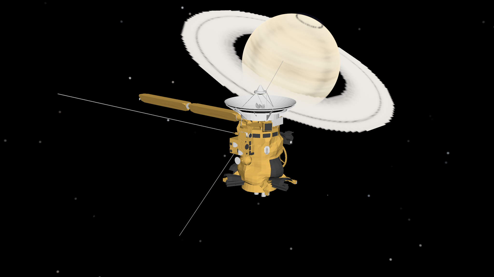
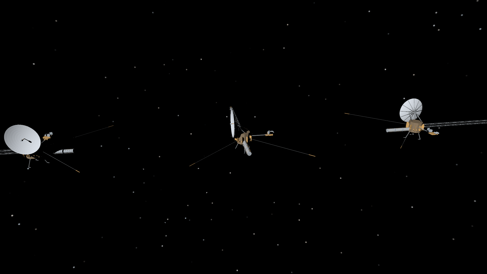

# spacecraft in Slayer



start with a spacecraft from the catalogue. put it in a YAML set, place
its camera and lights, then use a job to draw a still or move the camera
through the scene. the examples come with the sets, the jobs and the
resulting pictures.

## try a spacecraft

from the checkout root, after [building Slayer](../../../building.md):

```sh
game build slayer
game run slayer -- list kinds
game run slayer -- assess doc/model/spacecraft/guide/jobs/step-2-alone.yaml
game run slayer -- draw doc/model/spacecraft/guide/jobs/step-2-alone.yaml --out out/voyager.png
```

`assess` stages the job without tracing a frame. the examples request the
native Metal renderer. MP4 encoding uses AVFoundation on macOS. a job’s
paths are relative to its own file. the still command above uses `--out`
to keep the new picture in `out/`.

## place and light it

use the [Voyager set](sets/step-2-alone.yaml) as a starting point. the set
names the v2 schema and says `setting: space`. under `scene.set.things`,
`kind` selects the model and `seed` makes it reproducible. `complexity`
selects the representation. the catalogue lists the levels each kind makes.

- [lineup](jobs/step-1-lineup.yaml) places eight models with `east` and
  `north` in metres and optional `height`. a fixed camera’s `at` and
  `look_at` use `[east, north, up]`.
- [turning](jobs/step-3-turned.yaml) places three copies of Voyager 1 with
  headings of 0, 90 and 180 degrees clockwise from north.
- [Cassini and Huygens together](jobs/step-4-attached.yaml) uses the
  combined `cassini-huygens` kind. [the separated pair](jobs/step-8-released.yaml)
  places `cassini` and `huygens` individually at fixed positions.
- [Webb facing black space](jobs/step-5a-webb-black.yaml) and
  [the same mirror facing a bright sky](jobs/step-5b-webb-lit-sky.yaml)
  show how the surroundings change what a mirror reflects. the stars in
  these sets are seeded scenery from `world.sky.stars`.
- [Cassini with Saturn](jobs/step-6-saturn.yaml) uses a Saturn body template
  for the globe and rings. see the set’s [world vocabulary](../../../sets.md#the-world).




## move the camera

[the Cassini film job](jobs/step-7-orbit-film.yaml) reuses the Saturn set.
it asks for eight frames over two seconds and sets two straight camera
moves around Cassini. in a job’s camera path, `x` is east, `y` is up and
`z` is south. see [camera motion](../../../camera-motion.md) for the path
syntax.

```sh
game run slayer -- draw doc/model/spacecraft/guide/jobs/step-7-orbit-film.yaml
```

the movie goes to `out/spacecraft-orbit.mp4` and the numbered frames to
`out/spacecraft-orbit-frames/`.

[](images/step-7-orbit.mp4)

use a job for camera moves. `heading` turns a manufactured thing around
its vertical axis. [part-spin](../part-spin.md) can turn one native
material group about a local axis. the [set reference](../../../sets.md#a-scene-in-space)
lists the placement and staging limits, including undrawn orbits and attitudes.

## how the models are made

Voyager’s [constructor](../../../../manufacture/voyager.go) combines
procedural assemblies. its [dimensions](../../../../manufacture/voyager-numbers.yaml)
record their provenance, and its [finishes](../../../../manufacture/voyager-looks.csv)
record appearance choices. the Cassini and New Horizons kinds use adapted
NASA meshes. their source records describe the inputs and material choices.
[Cassini source record](../../../../manufacture/cassini-huygens/SOURCES.md),
[New Horizons source record](../../../../manufacture/new-horizons/SOURCES.md)

see [making models](../../../making-models.md) for the public factory API
and how to add a kind. the [catalogue menu](../../../../cmd/catalogue/menu.yaml)
records each kind’s sources, limitations and supported detail levels.
[maturity-2026-11-17.txt](maturity-2026-11-17.txt) records the geometry and
provenance counts measured for these models on that date.
