# slayer

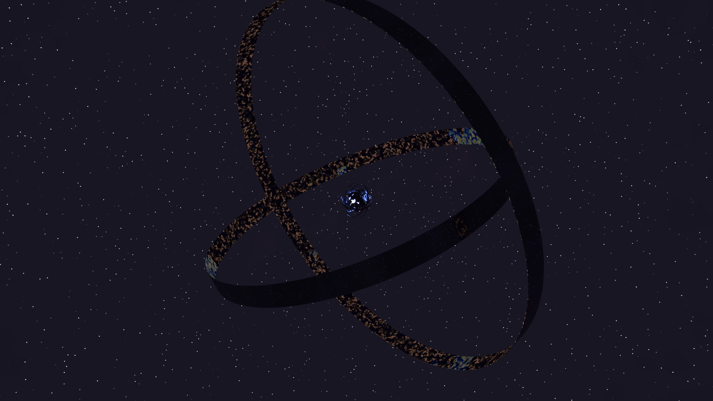

slayer is a ray tracer written in Go. it follows light backwards from a
camera through a scene, develops that light like film, and writes pictures
and films. on a Mac it can trace on the GPU through Metal.

the picture above is from the orbital scene. everything on this page was
drawn by slayer at the 2k size (2048 by 1152), except the Ferruccio
screenshots, the Grissom pictures, the small frames in step 7 and the two
films. the source is
[github.com/janearc/slayer](https://github.com/janearc/slayer).

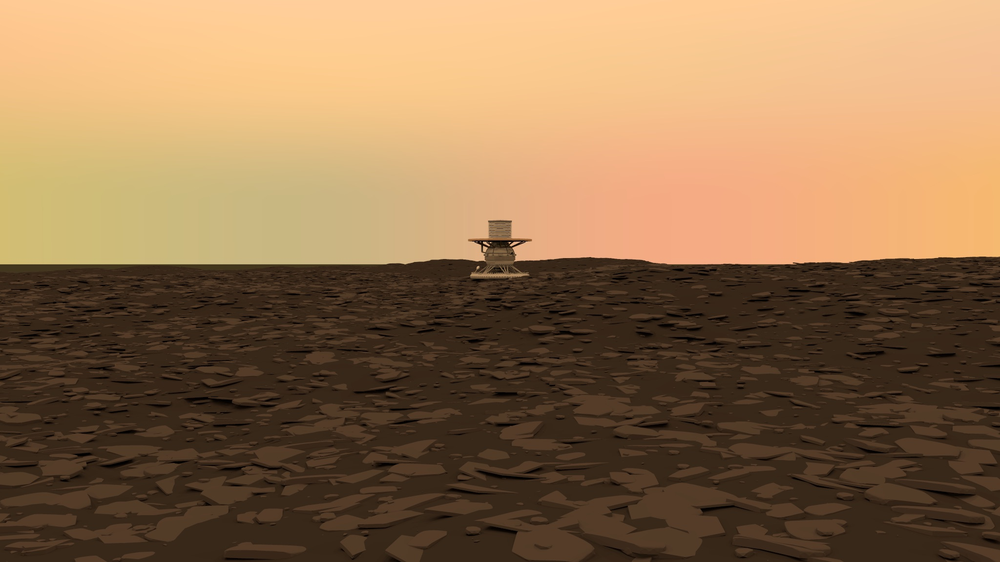

*a Venera lander on the plains of Venus.*

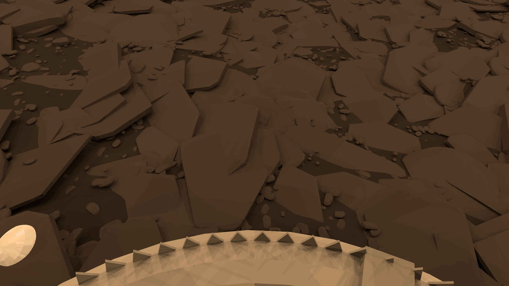

*the same lander, looking down past its landing ring at the slabs.*

contents:

1. [what you need](#what-you-need)
2. [get it and build it](#get-it-and-build-it)
3. [Ferruccio, the friendly way in](#ferruccio-the-friendly-way-in)
4. [the front door](#the-front-door)
5. [your first picture and film](#your-first-picture-and-film)
6. [a scene in YAML, step by step](#a-scene-in-yaml-step-by-step)
7. [a scene in Go](#a-scene-in-go)
8. [Grissom](#grissom)
9. [where to go next](#where-to-go-next)

## what you need

- **macOS with a Metal device** for the GPU renderer, plus Git and the Xcode
  command-line tools (`xcode-select --install`). the CPU renderer works
  without Metal.
- **Go 1.27.3**, the version named in `go.mod`.
- **Game**, the project runner slayer builds with:
  [github.com/janearc/game](https://github.com/janearc/game), v0.5.0 or
  newer. it reads the checkout's `.game` file for build steps, named runs
  and checks.
- **ffmpeg** on your PATH, for films made from jobs. pictures don't need it.
- **the source shelf**: a folder of your own that holds the datasets
  slayer's scenes are built from. the next section fetches it.

check your tools:

```sh
command -v game
game --age
go version
```

some installations name the Game executable `game5`; use that name wherever
this page says `game`.

## get it and build it

```sh
git clone https://github.com/janearc/slayer.git
cd slayer
export GOWORK=off
```

`GOWORK=off` keeps an enclosing Go workspace from quietly supplying
different modules. every command from here on runs from the checkout root.

### the shelf

the shelf holds the papers and datasets pinned in `sources.yaml`. a release
doesn't include it, so name a folder of your own, outside any Git checkout,
and set it **in your shell**:

```sh
export SLAYER_SHELF="$HOME/slayer/sources"
game run sources-fetch
game run sources-check
game run sources-verify
```

the fetch is about 2 GB, most of it one elevation model of Kilauea, and
keeps what it already has if you run it again. check holds the bytes to
their hashes; verify also checks the source pages behind published values.

put the `export` line in your shell's startup file so later builds find the
shelf. setting it in Game's config instead doesn't reach these runs today;
the shell does.

### build

```sh
game build
bin/slayer --age
```

`game build` checks the shelf first, then builds stamped commands into
`bin/`. `--age` says which build you have and where it came from. rebuild
after you change Go code.

## Ferruccio, the friendly way in

Ferruccio is a native workspace for writing slayer scenes. it opens a
scene's YAML, shows the picture beside the source, lets you move, turn and
look at things in the scene, and draws a real still through slayer. it's a
separate Go module inside the checkout, `ferruccio/native`, with a GoGPU
window on Metal.

### build it

the plain root build doesn't build Ferruccio, and the two need different cgo
settings: slayer needs cgo, Ferruccio's macOS bridge is pure Go and needs it
off.

```sh
export GOWORK=off
CGO_ENABLED=1 game build
cd ferruccio/native
CGO_ENABLED=0 game build
cd ../..
```

that gives you `bin/slayer` and `ferruccio/native/bin/ferruccio`.

### open it

`ferruccio` has three verbs: `open`, `proof` and `regress`. with nothing
after it, at a terminal, it is `open`. the preview runs your slayer through
Game, so tell it where both are, and give it a folder that already exists
for the previews it draws:

```sh
mkdir -p "$HOME/ferruccio-previews"
ferruccio/native/bin/ferruccio open --dry-run
ferruccio/native/bin/ferruccio open \
  --slayer "$PWD/bin/slayer" \
  --game "$(command -v game)" \
  --game-home "$GAME_HOME" \
  --evidence "$HOME/ferruccio-previews" \
  --examples ferruccio/examples \
  sets/ferruccio-playground.yaml
```

`--dry-run` opens nothing; the second command opens the window and takes
focus. `--game-home` is your Game configuration home, if you use one.
`sets/ferruccio-playground.yaml` is a known good scene and reads no
datasets; for scenes that do, add `--shelf "$SLAYER_SHELF"`.

in the window: Move, Turn and Look modes (`M`, `T`, `L`), two trackballs
(Orbit and Travel), Render fully, Preview, Source, Undo and Redo, a display
selector (Wireframe, Solid, Edges, Rendered), a theme selector, and type
from 16 to 24 points. Play gives the picture the window, Observe puts the
YAML beside it, and Compose enlarges it.

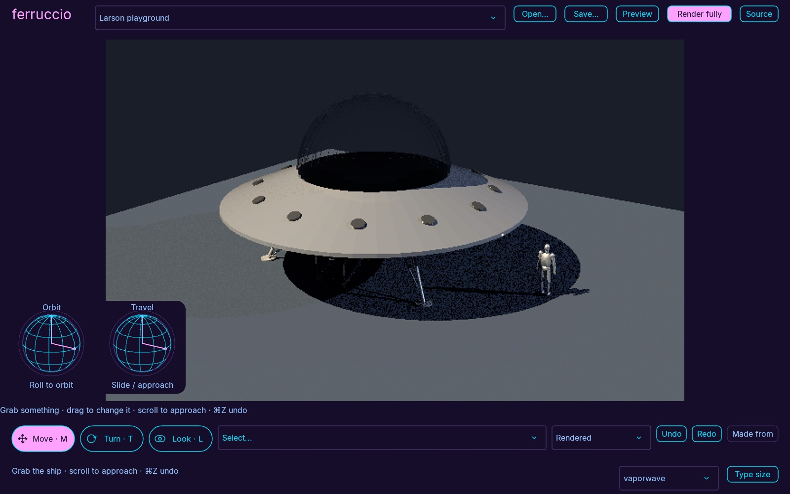

*Play: the Larson ship and a two-metre visitor, rendered, with the Orbit and
Travel trackballs.*

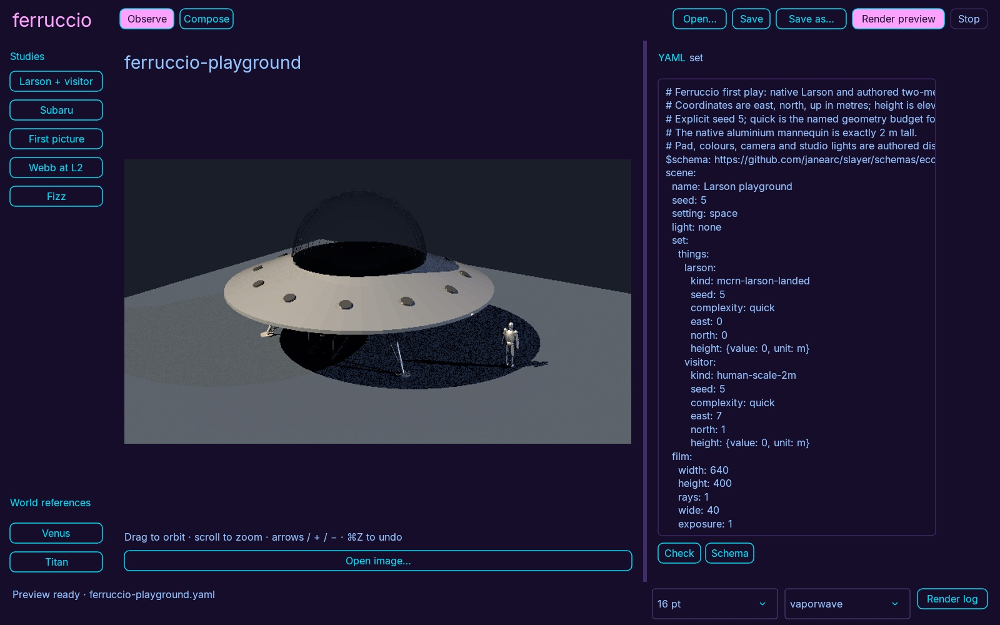

*Observe: the same scene with its YAML beside the picture and the scene list
on the left.*

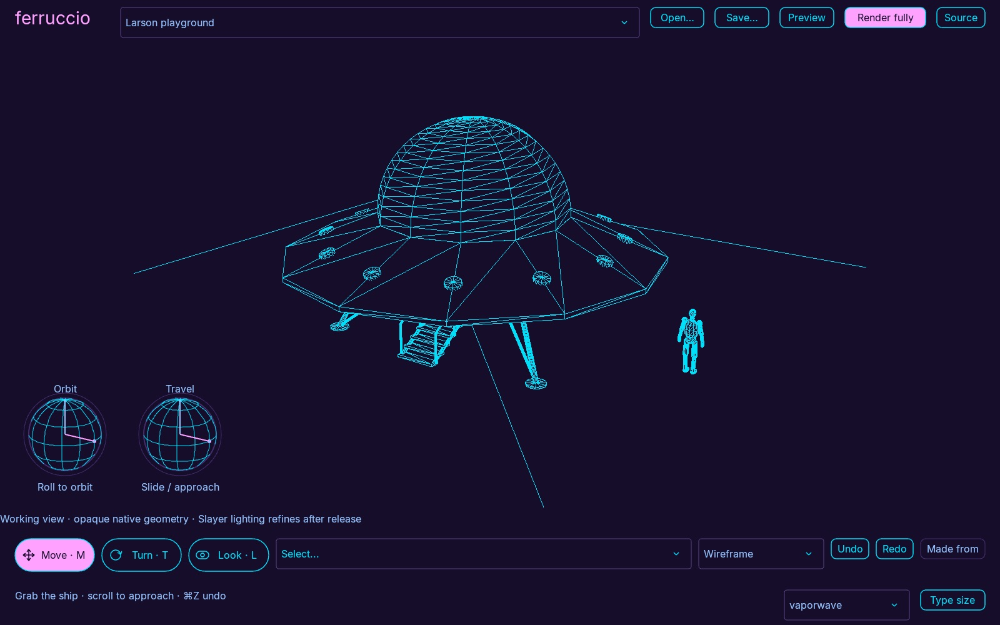

*Play in Wireframe: the live working geometry.*

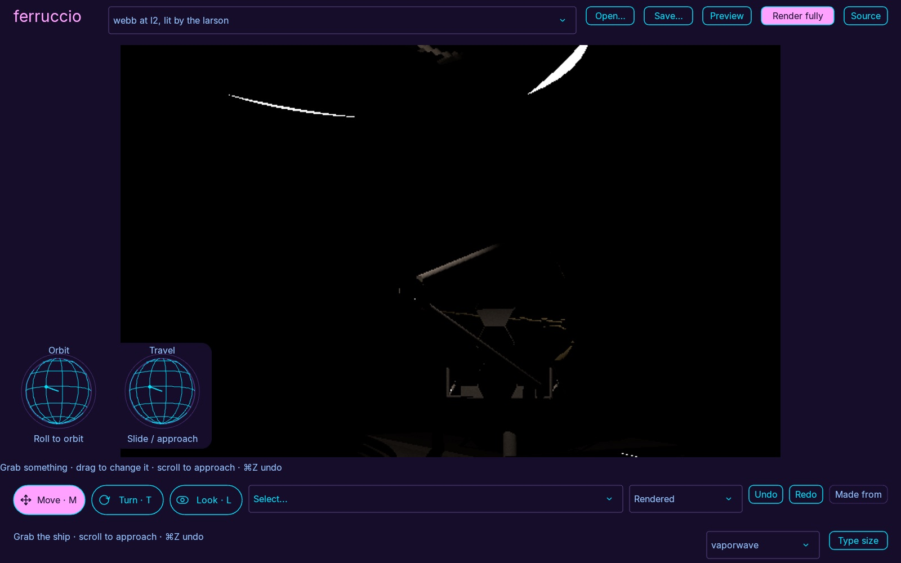

*Play with the `webb-at-l2` scene.*

### proof

`proof` draws the workspace without showing a window and exports it as a
1600 by 1000 PNG. the pictures above were made that way:

```sh
ferruccio/native/bin/ferruccio proof --background \
  --slayer "$PWD/bin/slayer" --game "$(command -v game)" \
  --game-home "$GAME_HOME" --evidence "$HOME/ferruccio-previews" \
  --file sets/ferruccio-playground.yaml --render \
  --composition play --out play.png
```

change `--composition` to `observe` or `compose`, or drop `--render` and
pass `--display wire` for the wireframe.

## the front door

`slayer` is one command with verbs. run it as `bin/slayer VERB`, or through
Game as `game run slayer -- VERB`; the words after `--` go to slayer.

- `draw` carries out a job and writes what it asks: a picture, frames, a
  film with its sound.
- `list` says what there is to draw and to draw with: scenes, smokes,
  presets, stocks, tunes, voicings.
- `assess` says whether a file will draw, drawing nothing, or judges a set
  or the smokes.
- `develop` turns raw light already drawn into pictures through a job's
  print or stock.
- `tunes` serves a tune library's audition page, or checks, films or pages
  its tunes.
- `cache` says what the disk caches hold, or empties them.
- `watch` draws a job live in the terminal as you edit it.
- `edit` lays out watch, your editor and the agent console in tmux.
- `schema` prints the job schema, or where its copy is.

```sh
bin/slayer --help
bin/slayer --agent-help
bin/slayer draw --help
bin/slayer list presets
```

`--agent-help` gives the same verb map, written for a coding agent. each
verb's own `--help` lists its arguments and flags. `slayer` with nothing
after it, at a terminal, is `slayer edit`.

there is also `slayer render FILE`, which draws a whole set file; the YAML
walkthrough below uses it.

## your first picture and film

slayer has two kinds of YAML. a **set** describes the world: ground, things,
lights, sky. a **job** describes the photograph or film: which scene, the
camera, the size and rays, the time, the sound, and what comes out. the
checkout comes with a first job, `doc/examples/jobs/first-picture.yaml`:

`doc/examples/jobs/first-picture.yaml`

```yaml
$schema: https://github.com/janearc/slayer/schemas/job-v1.json
scene: {smoke: 1}
renderer: cpu
film: {width: 160, height: 90, rays: 1}
at: {value: 0, unit: s}
outputs:
  picture: ../out/first-picture.png
  raw: ../out/first-picture.pfm
```

it draws smoke 1, one of slayer's small numbered test scenes, at 160 by 90
on the CPU. it needs no Metal and no terrain. check it, look at what it
would do, then draw it:

```sh
game run slayer -- assess doc/examples/jobs/first-picture.yaml
game run slayer -- draw doc/examples/jobs/first-picture.yaml --dry-run
game run slayer -- draw doc/examples/jobs/first-picture.yaml
```

assess checks the input without drawing. the dry run prints the job in its
full form and every file it would write. the draw writes
`out/first-picture.png` and `out/first-picture.pfm`. output paths in a job
are relative to the job file, not to your terminal.

try it bigger, with more rays:

```sh
game run slayer -- draw doc/examples/jobs/first-picture.yaml --width 320 --height 180 --rays 2
```

rays are counted per side: 2 means four rays a pixel, 4 means sixteen. going
from 2 to 4 is roughly four times the work. more rays help edges and noise;
they can't fix a camera pointed the wrong way.

the `.pfm` holds the linear light before development. change the job's print
settings and develop it again without tracing:

```sh
game run slayer -- develop doc/examples/jobs/first-picture.yaml out/first-picture.pfm
```

### first film

`doc/examples/jobs/first-film.yaml`

```yaml
$schema: https://github.com/janearc/slayer/schemas/job-v1.json
scene: {smoke: 1}
renderer: cpu
film: {width: 160, height: 90, rays: 1}
fps: 6
duration: {value: 3, unit: s}
sound:
  tune: ../cheeptune/examples/sunrun.json
  voicing: "@leap-dmg"
outputs:
  frames: ../out/first-film
  movie: ../out/first-film.mp4
```

three seconds at six frames a second, with a score played on slayer's own
synth, `cheeptune`. the scene holds still; this one checks frames, sound and
encoding. it needs ffmpeg.

```sh
game run slayer -- draw doc/examples/jobs/first-film.yaml --dry-run
game run slayer -- draw doc/examples/jobs/first-film.yaml
```

it writes `out/first-film.mp4` and numbered PNGs in `out/first-film/`.
control-c stops between frames; running the same job again on the same build
resumes where it stopped.

## a scene in YAML, step by step

eight steps, from bare ground to a short camera move over a real crater,
and then under the sea. the
ground is the US Geological Survey's 2019 lidar elevation model of Kilauea
Iki, the large dataset on the shelf. each set names the file it reads,
`unpacked/kil_2019dem/kil_2019dem.tif` under the shelf. the trees and stones
are grown by slayer's manufactory from a seed. no image files go in.

put the sets inside the checkout, for example in `sets/guide/`: slayer looks
for `sources.yaml` from the YAML's own folder upward. every step is a whole
file you can render on its own.

### step 1: ground and sky

`sets/guide/step-1.yaml`

```yaml
scene:
  name: step 1, ground and sky
  light: sun
  terrain:
    from: usgs-kilauea-2019-dem
    file: unpacked/kil_2019dem/kil_2019dem.tif
    west: 263000
    north: 2149000
    across: 1800
    down: 1300
    step: 4
  film:
    width: 2048
    height: 1152
    rays: 2
  cameras:
    across:
      orientation:
        point_to: the far stone
        alpha: -4
      location:
        loc_relative:
          object: the lookout
          standoff_x: 0
          standoff_y: 0
          standoff_z: 3
  set:
    things:
      the lookout:
        kind: cobble
        seed: 5
        east: 263850
        north: 2148720
      the far stone:
        kind: cobble
        seed: 6
        east: 264450
        north: 2148100
```

```sh
bin/slayer render sets/guide/step-1.yaml -out out/step-1.png
```

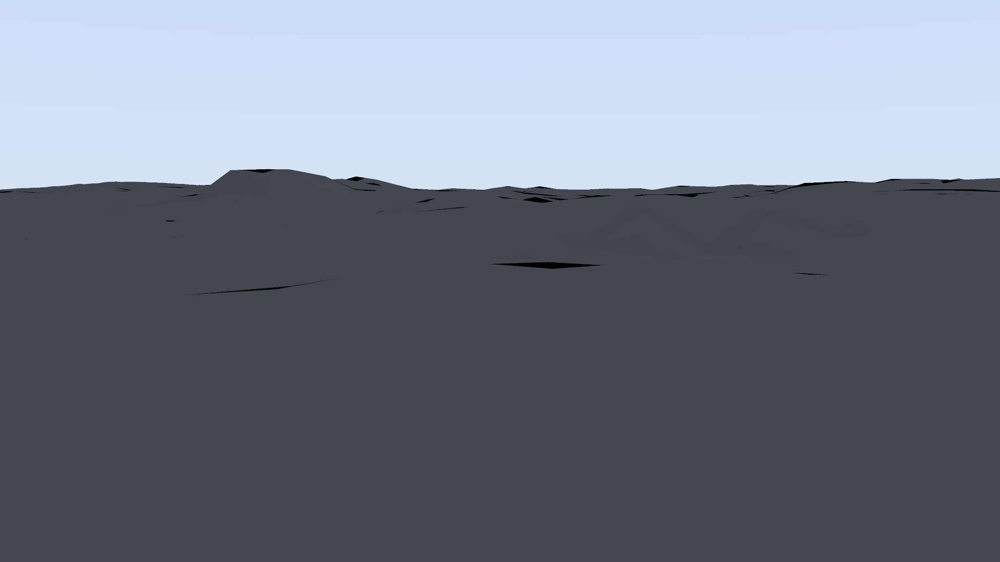

*step 1. the ground and the default sky.*

the smallest set that draws. `terrain` cuts a window 1800 by 1300 metres out
of the elevation model, sampled every 4 metres. a set with no terrain is
refused, so ground and sky come together.

a camera in a set stands off a named thing and points at a named thing, so
two plain stones (`cobble`) are here as its marks: it stands 3 m above
`the lookout` and looks toward `the far stone`, 4 degrees below level.
`rays: 2` is four rays a pixel.

### step 2: the sky from earth's air

added under scene:

```yaml
  air: earth
  location:
    lat: 19.4165
    lon: -155.2485
  timeofday: 1200
  sun:
    azimuth: 160
    altitude: 60
```

```sh
bin/slayer render sets/guide/step-2.yaml -out out/step-2.png
```

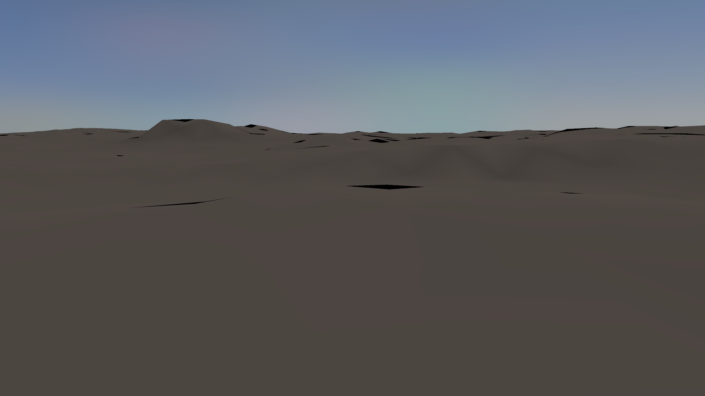

*step 2. a noon sun, high in the south-south-east.*

`air: earth` works the sky out from the standard atmosphere, the sun's place
and where you stand on the earth, instead of painting it. the exposure is
metered from that light, so the set doesn't say one. the ground reads dim
because the meter puts a noon scene at mid grey. `air` needs `light: sun`.

### step 3: one made thing

added under set: things:

```yaml
      the tree:
        kind: spruce
        seed: 3
        east: 263920
        north: 2148690
        stands_in_for: "ohia lehua, until the manufactory grows it"
```

```sh
bin/slayer render sets/guide/step-3.yaml -out out/step-3.png
```


*step 3. a spruce, about 70 m off, at the left edge.*

the manufactory grows the tree from its seed; the set only says where, in
the elevation model's metres. `stands_in_for` is free text kept with the
thing. the tree is small here on purpose; step 5 moves the camera to it.

### step 4: late afternoon

changed under scene:

```yaml
  timeofday: 1630
  sun:
    azimuth: 250
    altitude: 14
```

```sh
bin/slayer render sets/guide/step-4.yaml -out out/step-4.png
```

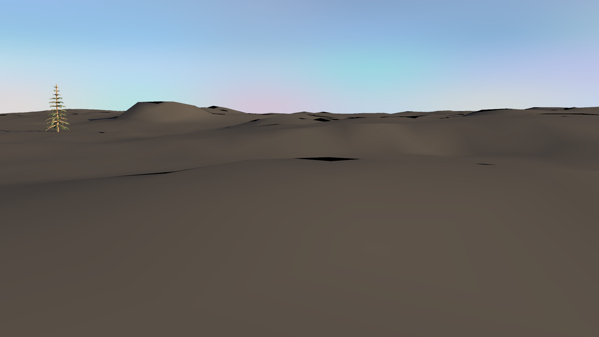

*step 4. the sun low in the west-south-west.*

the sun is 250 degrees clockwise from north and 14 degrees up, behind and to
the right of the camera, so shadows run long to the left and the sky warms.
the meter follows. it's the two `sun` numbers that do this: `timeofday` is
read and kept, and nothing in this build uses it yet.

### step 5: the camera placed with intent

the cameras block, replaced:

```yaml
  cameras:
    past the tree:
      orientation:
        point_to: the far stone
        alpha: -4
      location:
        loc_relative:
          object: the tree
          standoff_x: -30
          standoff_y: 19
          standoff_z: 2.5
```

```sh
bin/slayer render sets/guide/step-5.yaml -out out/step-5.png
```

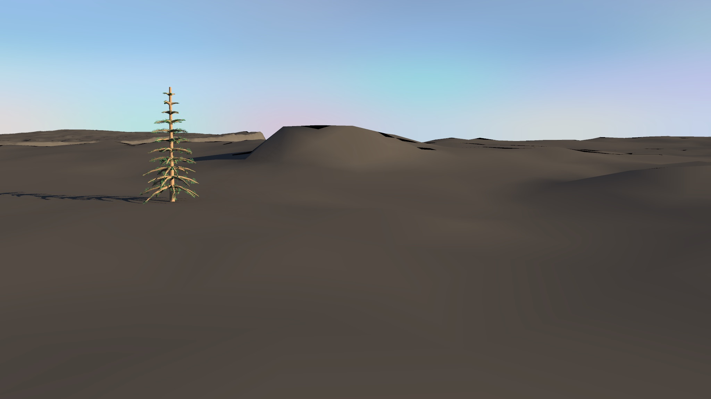

*step 5. the tree left of centre, the crater beyond.*

only the cameras block changes. the camera now stands off the tree:
`standoff_x` is metres east of it, `standoff_y` metres north, `standoff_z`
metres up, so 30 m west, 19 m north and 2.5 m up. it still points at the far
stone.

`alpha` is degrees up from level, not from the line to the target. expect to
try a placement, look, and adjust; these numbers took two goes.

### step 6: a stand of trees

added under set:

```yaml
    stands:
      trees on the rim:
        kind: spruce
        count: 160
        seed: 11
        above: 1150
        stands_in_for: "ohia lehua, until the manufactory grows it"
```

```sh
bin/slayer render sets/guide/step-6.yaml -out out/step-6.png
```

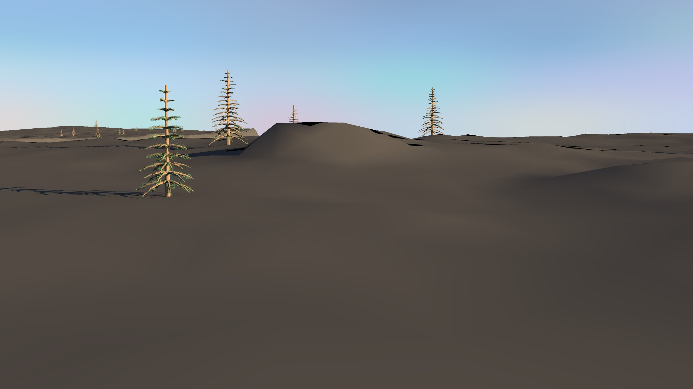

*step 6. 160 spruces on the rim; most stand outside this frame.*

a stand is many of one kind, grown on the ground from one seed: here 160
spruces wherever the ground is above 1150 m. the single tree stays and the
stand grows round it. a few show on the horizon here; step 7 rises to see
more.

### step 7: a short camera move

this one is a job, not a set. it names the step 6 set, sizes the frames, and
gives the camera a path.

`sets/guide/step-7.yaml`

```yaml
$schema: https://github.com/janearc/slayer/schemas/job-v1.json
scene: {set: step-6.yaml}
film: {preset: 320, rays: 1}
fps: 4
duration: {value: 2, unit: s}
camera:
  unit: m
  look-at: {x: 1450, y: 15, z: 900}
  moves:
    - from: {x: 890, y: 131, z: 291}
      to: {x: 890, y: 146, z: 291}
      duration: {value: 2, unit: s}
      ease: smooth
outputs:
  frames: step-7-frames
```

the set's path is relative to the job. `fps: 4` over 2 seconds is eight
frames at the `320` preset, 320 by 180. the camera looks at one fixed point
on the crater floor and rises 15 m in two seconds; `ease: smooth` starts and
stops it gently.

points in a camera path are x east, y up and z south, in metres from the
terrain window's north-west corner, with y measured from the window's lowest
ground. there's no verb yet that prints the ground's height at a spot, so
find a starting height by drawing a test frame and looking. 131 m came from
doing that.

the same move as one 2k still, drawn 1.5 seconds in:

`sets/guide/step-7-still.yaml`

```yaml
$schema: https://github.com/janearc/slayer/schemas/job-v1.json
scene: {set: step-6.yaml}
film: {preset: 2k, rays: 2}
at: {value: 1.5, unit: s}
camera:
  unit: m
  look-at: {x: 1450, y: 15, z: 900}
  moves:
    - from: {x: 890, y: 131, z: 291}
      to: {x: 890, y: 146, z: 291}
      duration: {value: 2, unit: s}
      ease: smooth
outputs:
  picture: step-7-2k.png
```

```sh
bin/slayer draw sets/guide/step-7.yaml
bin/slayer draw sets/guide/step-7-still.yaml
```

the frames land in `sets/guide/step-7-frames/` and the still in
`sets/guide/step-7-2k.png`, beside the jobs. to draw frames again that
slayer already holds, add `--fresh`.

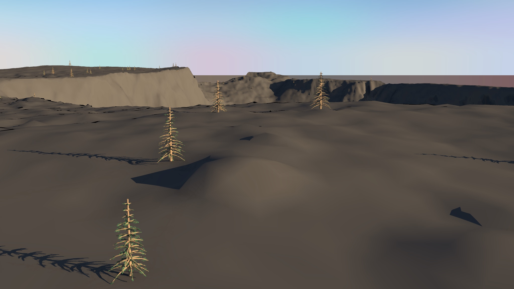

*step 7 at 2k: from the rim of Kilauea Iki, 1.5 seconds into the move.*

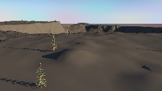
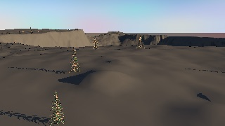
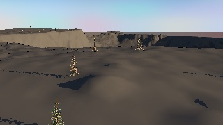
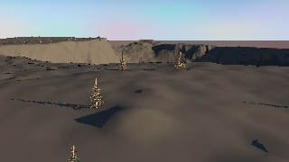

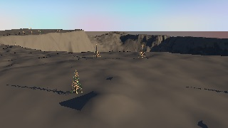
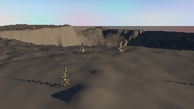
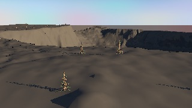
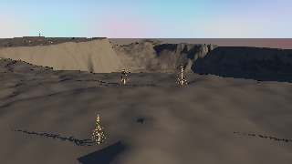

*the eight frames of step 7 at 320 by 180, left to right, top to bottom. the
2k still is frame 7.*

### step 8: the Alfa in the sea

this one leaves the crater and goes under the sea. it draws the Alfa,
Project 705 "Lira", a titanium attack submarine 81.4 m long, from below,
60 m down, in moonlight that has come through the water. the look is the
approved underwater control's: a dark boat against faint blue-green water,
with the gas from its screw behind it.

the whole set is `sets/guide/step-8.yaml` and the job that draws it is
`sets/guide/step-8-job.yaml`; the pieces that matter are here.

the set is version 2, and `setting: space` means no ground and no air of
its own. the moon is the only light:

```yaml
$schema: https://github.com/janearc/slayer/schemas/ecosystem-v2.json
scene:
  setting: space
  light: moon
  moon: {azimuth: 230, altitude: 40, disc: false}
  film: {width: 2048, height: 1152, rays: 2, exposure: 100000}
```

the sea is a material and a sheet of water:

```yaml
  world:
    materials:
      seawater:
        clear:
          through: 1
          index: 1.333
          gloss: 1
          extinction-per-metre: [0.03, 0.008, 0.004]
          scatter:
            coefficient-per-metre: [0.005, 0.003, 0.002]
            phase-g: 0
            steps: 64
            max-distance: {value: 160, unit: m}
    ocean:
      material: seawater
      direct-moon: mean-plane
      middle: [-1500, 0, 0]
      sea:
        wind: {value: 0, unit: m/s}
        fetch: {value: 0, unit: m}
        depth: {value: 0, unit: m}
        toward: {value: 0, unit: rad}
```

the gas and the boat:

```yaml
    fizzes:
      residual-gas:
        foot: [-1563.3763, 174.1248, -55.226]
        axis: [0.342, -0.94, 0.03]
        radius: 0.6
        height: 20
        clear-water: true
  set:
    things:
      the Alfa:
        kind: alfa-hero
        complexity: demo
        position:
          east: {value: -1576.9545, unit: m}
          north: {value: 211.4308, unit: m}
          up: {value: -60, unit: m}
        heading: {value: 340, unit: deg}
```

and the camera, which stands in the water:

```yaml
  cameras:
    under the sea:
      location: {at: [-1641.0791, 265.2377, -70.0101]}
      orientation: {look_at: [-1576.9545, 211.4308, -55.25]}
      initial-media: [seawater]
```

the file in `sets/guide/` holds every key and every digit, so draw that one:

```sh
bin/slayer draw sets/guide/step-8-job.yaml
```

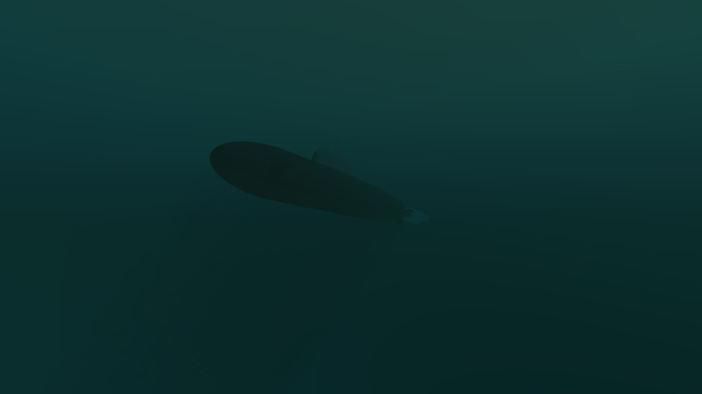

*step 8. the Alfa, 60 m down, seen from below in moonlight through the
water.*

what is new:

- `light: moon` lights the scene from the moon, set by `moon`: `azimuth` and
  `altitude` in degrees. `disc: false` draws no lunar surface in the sky.
  `exposure` multiplies the light, and moonlight is faint, so it is large.
- `clear` makes the seawater a glass-like surface. `index` bends the light.
  `through` and `gloss` say how much passes and how much reflects.
- `extinction-per-metre` is how fast red, green and blue are lost to the
  water, each a share per metre. red goes first, which is why it is blue-green
  down here.
- `scatter` adds light the water throws sideways. `phase-g` of 0 sends it
  every way alike. `steps` and `max-distance` bound the sum along each ray.
- `ocean` is the sheet of water at `middle`. wind, fetch, depth and
  direction are all zero, so it is flat. `direct-moon: mean-plane` lets the
  moon's light enter the water, bent at the surface.
- `initial-media: [seawater]` tells the camera it starts under the water.
  slayer does not work that out from where it stands.
- `kind: alfa-hero` is the boat in its near-black finish. `complexity: demo`
  is the small build, and `position` puts it 60 m below the surface.
- `fizzes` is a plume of residual gas, set by where its foot stands and which
  way it runs. it is an authored cloud, not single bubbles. `clear-water: true`
  has it lit through the water.
- in the job, `renderer: gpu` draws on Metal, `quality: exact` keeps every
  ray, `tall: 60` makes the lens 60 degrees from top to foot, and `print`
  sets the development: `stops: 10` is ten stops of light held.

the same file carries two more things: a `vapor-cavities` block for the
screw's cavitation, and a `part-spin` that holds the screw at one turn of its
spin. Metal can draw this because the water is flat; a sea with waves is a
job for the CPU.

## a scene in Go

YAML says where things are. Go lets a rule say it: positions, sizes, colours
and motion from a loop, so 12 balls and 377 balls are the same length of
code. this example is five small programs, `step1` to `step5`, each a whole
`package main` in its own folder of one module. it reads no data files and
needs no shelf.

layout:

```text
example/
  go.mod          module example.com/slayer-guide
  step1/main.go
  step2/main.go
  step3/main.go
  step4/main.go
  step5/main.go
```

the module needs slayer itself. there isn't a published slayer version that
builds as a library yet, so point at your clone with a `replace` line, as
this example did:

`go.mod`

```text
module example.com/slayer-guide

go 1.27.3

require github.com/janearc/slayer v0.0.0

replace github.com/janearc/slayer => ../slayer
```

then, from `example/`:

```sh
export GOWORK=off
go mod tidy
go build -o bin/ ./...
bin/step1 -out step1-2k.png
```

every step takes `-out`, `-width`, `-height` and `-rays` (rays a side; the
default 4 is sixteen a pixel). the size defaults to 2048 by 1152, what
slayer calls 2k. one unit is one metre, y is up, and the camera looks down
negative z.

### step 1: a ball on a floor

`step1/main.go`: build and render

```go
// build makes the world: a floor, a ball, a sun, a fill and a sky.
func build() *thing.World {
	world := thing.NewWorld()
	world.Add(thing.Thing{
		Shape:    shape.Plane{},
		Material: thing.Diffuse("floor", maths.Grey(0.6)),
		Motion:   thing.Still(maths.Local()),
	})
	world.Add(thing.Thing{
		Shape:    shape.Sphere{Radius: ballRadius},
		Material: thing.Diffuse("ball", maths.RGB(0.8, 0.25, 0.2)),
		Motion: thing.Still(maths.Subspace{
			Origin: maths.V(0, ballRadius, 0)}),
	})
	world.Lamp(thing.Sun(toSun.Unit(), maths.Grey(sunStrength)))
	world.Lamp(film.Flood{Strength: maths.Grey(fillStrength)})
	world.Sky = sky.Gradient{
		Horizon: maths.RGB(0.7, 0.8, 0.95),
		Zenith:  maths.RGB(0.25, 0.4, 0.8),
		Ground:  maths.Grey(0.3),
	}
	return world
}

// render traces the world once and develops it into a picture.
func render(world *thing.World, width, height, rays int, cpu bool,
	at time.Duration) (*image.RGBA, error) {
	lens, err := film.PinholeOf(lensDegrees * maths.Degree)
	if err != nil {
		return nil, err
	}
	place := maths.Subspace{Origin: eye,
		Orientation: maths.LookAt(eye, target)}
	draw := gpu.Sampled
	if cpu {
		draw = trace.Sampled
	}
	light, err := draw(world, place, *lens, at, width, height, rays)
	if err != nil {
		return nil, err
	}
	tone := colour.Tone{Exposure: exposure, Knee: knee, Top: top}
	return tone.Develop(light), nil
}
```

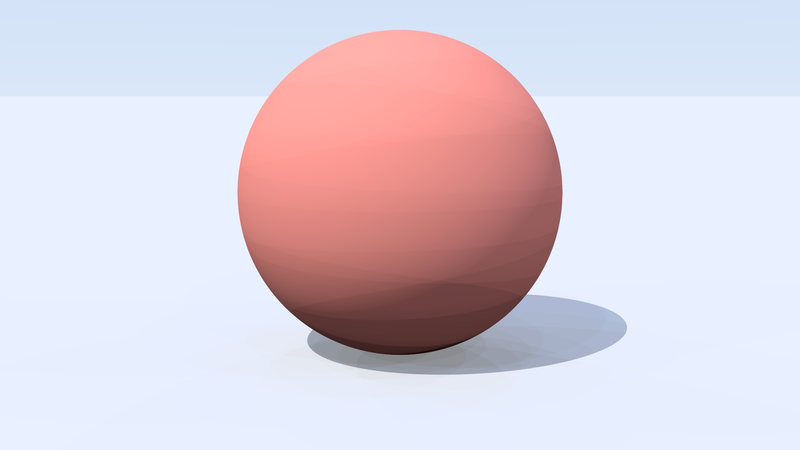

*step 1. one ball, one floor, a sun and a fill light.*

the smallest working scene, so every later step is a small edit to it. a
thing is a shape, a material and a motion; `thing.Still` is a motion that
doesn't move. `gpu.Sampled` traces on Metal, `trace.Sampled` on the CPU, and
`colour.Tone` develops the linear light into a picture.

<details>
<summary>the whole file: step1/main.go</summary>

```go
// Command step1 draws one ball on a floor: the smallest scene built in Go.
//
// It is the first of four stills (step1 to step4) and a film (step5). Each
// is a whole program; diff one against the next to see what a step adds.
package main

import (
	"flag"
	"fmt"
	"image"
	"os"
	"time"

	"github.com/janearc/slayer/film"
	"github.com/janearc/slayer/gpu"
	"github.com/janearc/slayer/interfaces/file"
	"github.com/janearc/slayer/maths"
	"github.com/janearc/slayer/render/colour"
	"github.com/janearc/slayer/scene/shape"
	"github.com/janearc/slayer/scene/sky"
	"github.com/janearc/slayer/scene/thing"
	"github.com/janearc/slayer/trace"
)

// The size slayer calls 2k: job/presets.yaml names it 2048 by 1152.
const (
	defaultWidth  = 2048 // pixels across, the "2k" preset
	defaultHeight = 1152 // pixels down, the "2k" preset
	defaultRays   = 4    // rays per axis per pixel: 4 means 16 per pixel
)

// The scene's numbers. One unit is one metre; y is up.
const (
	ballRadius   = 1.0  // picked: a one metre ball
	lensDegrees  = 45.0 // picked: how much the pinhole sees across
	sunStrength  = 3.0  // picked: bright enough for white paint to read white
	fillStrength = 0.35 // picked: fill, so shadows are not black
	exposure     = 1.0  // picked: the darkroom's multiplier
	knee         = 0.8  // picked: where highlights start to roll off
	top          = 8.0  // picked: the brightest light the picture holds
)

// eye and target are where the camera stands and what it looks at.
var (
	eye    = maths.V(0, 1.6, 6)   // picked: a little above the ball, back
	target = maths.V(0, 0.8, 0)   // picked: the ball's middle
	toSun  = maths.V(-0.5, 1, 0.6) // picked: where the sun is, up and left
)

// build makes the world: a floor, a ball, a sun, a fill and a sky.
func build() *thing.World {
	world := thing.NewWorld()
	world.Add(thing.Thing{
		Shape:    shape.Plane{},
		Material: thing.Diffuse("floor", maths.Grey(0.6)),
		Motion:   thing.Still(maths.Local()),
	})
	world.Add(thing.Thing{
		Shape:    shape.Sphere{Radius: ballRadius},
		Material: thing.Diffuse("ball", maths.RGB(0.8, 0.25, 0.2)),
		Motion: thing.Still(maths.Subspace{
			Origin: maths.V(0, ballRadius, 0)}),
	})
	world.Lamp(thing.Sun(toSun.Unit(), maths.Grey(sunStrength)))
	world.Lamp(film.Flood{Strength: maths.Grey(fillStrength)})
	world.Sky = sky.Gradient{
		Horizon: maths.RGB(0.7, 0.8, 0.95),
		Zenith:  maths.RGB(0.25, 0.4, 0.8),
		Ground:  maths.Grey(0.3),
	}
	return world
}

// render traces the world once and develops it into a picture.
func render(world *thing.World, width, height, rays int, cpu bool,
	at time.Duration) (*image.RGBA, error) {
	lens, err := film.PinholeOf(lensDegrees * maths.Degree)
	if err != nil {
		return nil, err
	}
	place := maths.Subspace{Origin: eye,
		Orientation: maths.LookAt(eye, target)}
	draw := gpu.Sampled
	if cpu {
		draw = trace.Sampled
	}
	light, err := draw(world, place, *lens, at, width, height, rays)
	if err != nil {
		return nil, err
	}
	tone := colour.Tone{Exposure: exposure, Knee: knee, Top: top}
	return tone.Develop(light), nil
}

// main reads the flags, draws one frame and writes a PNG.
func main() {
	out := flag.String("out", "step1.png", "PNG to write")
	width := flag.Int("width", defaultWidth, "pixels across")
	height := flag.Int("height", defaultHeight, "pixels down")
	rays := flag.Int("rays", defaultRays, "rays per axis per pixel")
	cpu := flag.Bool("cpu", false, "trace on the CPU, not the GPU")
	flag.Parse()
	started := time.Now()
	picture, err := render(build(), *width, *height, *rays, *cpu, 0)
	if err == nil {
		err = file.PNG(*out, picture, 1)
	}
	if err != nil {
		fmt.Fprintln(os.Stderr, "step1:", err)
		os.Exit(1)
	}
	fmt.Printf("step1: %s in %s\n", *out, time.Since(started).Round(time.Millisecond))
}
```

</details>

### step 2: a ring, placed by a rule

`step2/main.go`: the one ball becomes ring(world, 12, 3.0)

```go
// hue is a fully saturated colour for a fraction of the way round the
// colour wheel, from zero to one, scaled to a paint's reflectance.
func hue(fraction float64) maths.Light {
	const paint = 0.75 // picked: no paint gives back all of its light
	channel := func(shift float64) float64 {
		wave := 0.5 + 0.5*math.Cos(turn*(fraction-shift))
		return paint * (0.15 + 0.85*wave)
	}
	return maths.RGB(channel(0), channel(1.0/3), channel(2.0/3))
}

// ring adds count balls on a circle of the given radius, resting on the
// floor, each coloured by where it stands.
func ring(world *thing.World, count int, radius float64) {
	for number := range count {
		fraction := float64(number) / float64(count)
		angle := turn * fraction
		world.Add(thing.Thing{
			Shape:    shape.Sphere{Radius: ballRadius},
			Material: thing.Diffuse(fmt.Sprintf("ball-%d", number), hue(fraction)),
			Motion: thing.Still(maths.Subspace{Origin: maths.V(
				radius*math.Cos(angle), ballRadius, radius*math.Sin(angle))}),
		})
	}
}
```

```sh
bin/step2 -out step2-2k.png
```

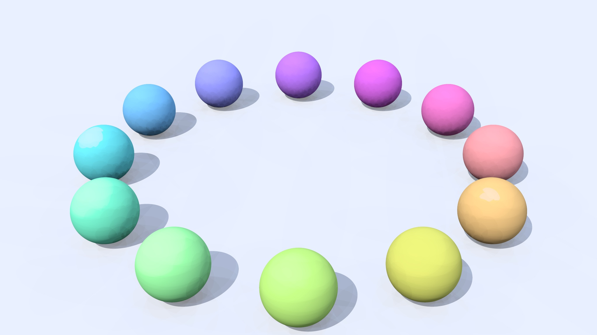

*step 2. twelve balls, the colour following the angle.*

ball n stands at angle 2πn/12 and takes `hue(n/12)`, so one number drives
both where it stands and what colour it is. the rest of the file is step 1's,
with the camera raised to see the ring's shape (`eye = maths.V(0, 5.5, 8.5)`)
and the new numbers named as constants.

### step 3: a sunflower, by the golden angle, with a seed

`step3/main.go`: ring becomes sunflower(world, 377, seed)

```go
// goldenAngle is the angle that splits a turn in the golden ratio, about
// 137.5 degrees: the angle between neighbouring seeds in a sunflower.
var goldenAngle = math.Pi * (3 - math.Sqrt(5))

// seedAt is where ball number n stands on the floor plan: its distance
// from the middle and its angle round.
func seedAt(number int) (distance, angle float64) {
	return spacing * math.Sqrt(float64(number)), goldenAngle * float64(number)
}

// sunflower adds count balls by the golden angle. The seed varies their
// sizes and colours and nothing else.
func sunflower(world *thing.World, count int, seed uint64) {
	edge, _ := seedAt(count)
	for number := range count {
		distance, angle := seedAt(number)
		size := spacing * fitness * (1 + scatter*(2*noise.Hash2(seed, int64(number), sizeStream)-1))
		fraction := colourTurns * distance / edge
		fraction += hueScatter * (2*noise.Hash2(seed, int64(number), hueStream) - 1)
		lift := mound * math.Exp(-moundWidth*(distance/edge)*(distance/edge))
		world.Add(thing.Thing{
			Shape:    shape.Sphere{Radius: size},
			Material: thing.Diffuse(fmt.Sprintf("seed-%d", number), hue(fraction)),
			Motion: thing.Still(maths.Subspace{Origin: maths.V(
				distance*math.Cos(angle), size+lift, distance*math.Sin(angle))}),
		})
	}
}
```

```sh
bin/step3 -out step3-2k.png -seed 11
```

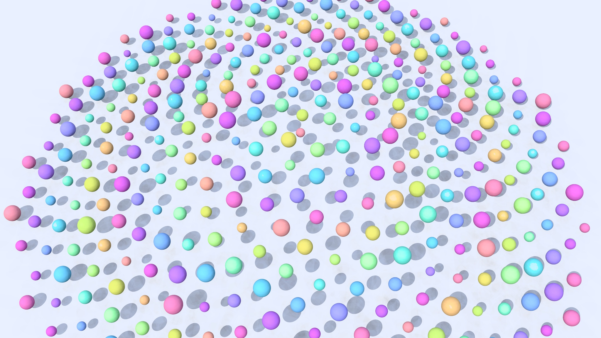

*step 3. 377 balls, each turned 137.5 degrees from the last.*

a rule too long to type by hand. ball n is 0.32×√n metres out, turned n
golden angles, and a Gaussian mound lifts the middle. `noise.Hash2` turns
the seed and the ball's number into a steady small change in size and
colour: the same seed gives the same flower, and `-seed` picks another one.
the camera moves back and up to take it all in.

### step 4: motion from maths

`step4/main.go`: thing.Still gives way to a motion of our own

```go
// Ripple is a motion: a ball that rests at Rest and rises and falls as a
// wave runs outward from the vertical axis through Centre.
type Ripple struct {
	Rest   maths.Vec // where the ball stands when the wave is not there
	Centre maths.Vec // where the wave starts from; only x and z are used
}

// At is the ball's place at elapsed time t. The wave's phase falls with
// distance from the centre, so crests travel outward.
func (r Ripple) At(t time.Duration) maths.Subspace {
	across := math.Hypot(r.Rest.X-r.Centre.X, r.Rest.Z-r.Centre.Z)
	phase := turn * (t.Seconds()/wavePeriod - across/waveLength)
	rise := waveHeight * (1 + math.Sin(phase)) / 2
	return maths.Subspace{Origin: r.Rest.Add(maths.V(0, rise, 0))}
}

// in sunflower, each ball now takes:
//	Motion: Ripple{Rest: maths.V(distance*math.Cos(angle),
//		size+lift, distance*math.Sin(angle))},
```

```sh
bin/step4 -out step4-2k.png -at 0.4
```

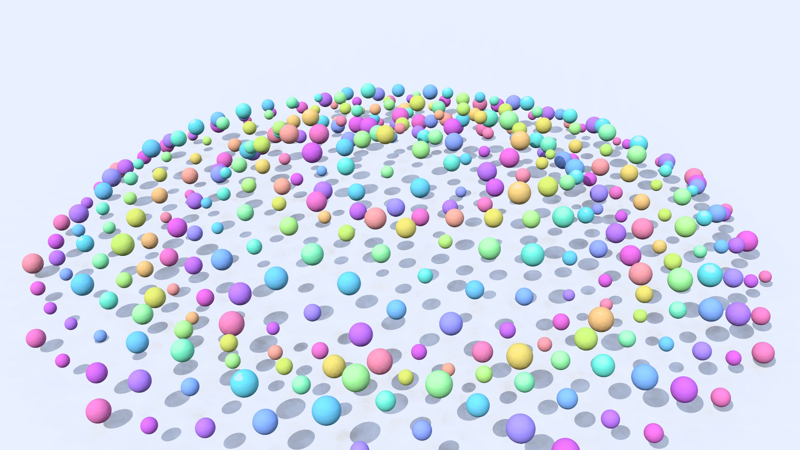

*step 4. the wave at 0.4 seconds.*

a motion is any value with an `At(time)` method that says where a thing
stands at that moment. slayer asks it once a frame, so one world serves
every instant, and `-at` picks the instant. in a still the wave shows only
as uneven heights; the film shows it moving.

### step 5: a film, with music

step 5 is step 4 with a loop over time. frame n is drawn at n/24 seconds, the
camera goes a quarter turn round the flower by a rule of time, and each
developed frame goes straight to slayer's movie writer. the soundtrack is a
`cheeptune` score built into slayer.

there are no frame files and no ffmpeg here: the writer encodes through
AVFoundation, so it works on macOS only. it wants an even width, a height
that's a multiple of 16 (352 is 22 × 16), and 24 or 30 frames a second.

`step5/main.go`: the camera, the sound, the film

```go
// eyeAt is where the camera stands at a moment: round the flower by a rule
// of time. It goes swing of a turn in the film's length and is a function
// of time alone, so any frame can be drawn without the ones before it.
func eyeAt(at time.Duration, length float64) maths.Vec {
	angle := startAngle - turn*swing*at.Seconds()/length
	return maths.V(eyeDistance*math.Cos(angle), eyeHeight,
		eyeDistance*math.Sin(angle)+target.Z)
}

// soundtrack renders a score through a voicing and hands it to the movie
// writer's own type: stereo samples, left then right, interleaved.
func soundtrack(score, voicing string) (movie.Sound, error) {
	piece, err := cheeptune.Open(score, voicing)
	if err != nil {
		return movie.Sound{}, err
	}
	mixed := make([]float32, 0, 2*len(piece.Left))
	for at := range piece.Left {
		mixed = append(mixed, piece.Left[at], piece.Right[at])
	}
	return movie.NewSound(piece.Rate, mixed)
}

// makeFilm draws every frame and writes them, with the sound, to a movie.
func makeFilm(path string, world *thing.World, length float64, rate int,
	sound movie.Sound, cpu bool) error {
	frames := int(math.Round(length * float64(rate)))
	settings, err := movie.NewSettings(movie.Request{Path: path,
		Width: filmWidth, Height: filmHeight, Rate: rate, Frames: frames,
		Sound: sound, Replace: true})
	if err != nil {
		return err
	}
	writer, err := movie.New(context.Background(), settings)
	if err != nil {
		return err
	}
	for number := range frames {
		at := time.Duration(float64(number) / float64(rate) * float64(time.Second))
		picture, err := render(world, [2]int{filmWidth, filmHeight}, filmRays, cpu, at, length)
		if err == nil {
			err = writer.Frame(number, picture)
		}
		if err != nil {
			writer.Abort()
			return err
		}
	}
	return writer.Close()
}
```

```sh
bin/step5 -out step5-film.mp4
bin/step5 -still step5-2k.png -at 1.0
```

[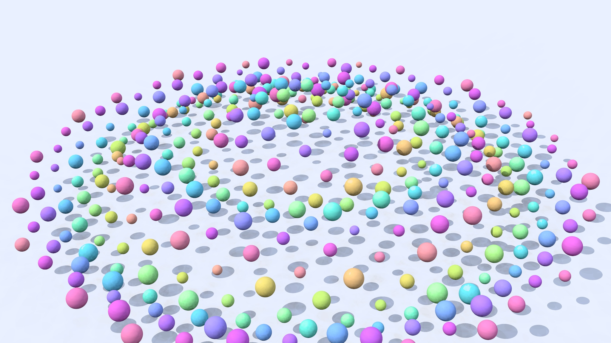](film.mp4)

*step 5: three seconds, 72 frames at 640 by 352, with the `@leap` score on
the `@leap-dmg` voicing. the sound starts when you press play. the picture
links to the film, [film.mp4](film.mp4); GitHub doesn't play video from a
page, so download it or open it directly.*


*step 5 as a 2k still, one second in.*

<details>
<summary>the whole file: step5/main.go</summary>

```go
// Command step5 makes the moving sunflower into a film with music.
//
// It is step4 with a loop over time. For each frame it asks the world for
// its instant (frame number over frames a second), moves the camera round
// by a rule of time as well, develops the frame, and hands it to the movie
// writer. A score rendered by cheeptune is the soundtrack. With -still it
// draws one frame, at -at seconds, to a PNG instead: the 2k picture.
package main

import (
	"context"
	"flag"
	"fmt"
	"image"
	"math"
	"os"
	"time"

	"github.com/janearc/slayer/cheeptune"
	"github.com/janearc/slayer/film"
	"github.com/janearc/slayer/gpu"
	"github.com/janearc/slayer/interfaces/file"
	"github.com/janearc/slayer/interfaces/movie"
	"github.com/janearc/slayer/maths"
	"github.com/janearc/slayer/maths/noise"
	"github.com/janearc/slayer/render/colour"
	"github.com/janearc/slayer/scene/shape"
	"github.com/janearc/slayer/scene/sky"
	"github.com/janearc/slayer/scene/thing"
	"github.com/janearc/slayer/trace"
)

// The sizes. The film is small so that its frames are quick; the still is
// the size slayer calls 2k (job/presets.yaml: 2048 by 1152). Heights are
// multiples of 16, which the movie writer requires.
const (
	filmWidth  = 640  // picked: pixels across a film frame
	filmHeight = 352  // picked: pixels down; 22 times 16
	stillWidth = 2048 // pixels across, the "2k" preset
	stillHigh  = 1152 // pixels down, the "2k" preset
	filmRays   = 2    // picked: rays per axis per pixel in the film
	stillRays  = 4    // picked: rays per axis per pixel in the still
)

// The film's numbers.
const (
	defaultSeconds = 3.0         // picked: length of the film
	defaultRate    = 24          // frames a second; the movie writer offers 24 and 30
	defaultScore   = "@leap"     // picked: a score built into cheeptune
	defaultVoicing = "@leap-dmg" // picked: a voicing built into cheeptune
	swing          = 0.25        // picked: share of a turn the camera goes round in the film
)

// The sunflower's numbers. One unit is one metre; y is up.
const (
	seedCount   = 377  // defined: a Fibonacci number
	spacing     = 0.32 // picked: metres of radius per square root of a ball
	fitness     = 0.42 // picked: a ball's radius over spacing
	scatter     = 0.35 // picked: how far a seed may change a ball's size, as a share
	mound       = 1.6  // picked: how high the middle is lifted, in metres
	moundWidth  = 3.0  // picked: how quickly the lift falls off with distance
	defaultSeed = 11   // picked: any number; the same number gives the same flower
	colourTurns = 3.0  // picked: times the colour wheel goes round, middle to edge
	sizeStream  = 0    // defined: which hash stream sets a ball's size
	hueStream   = 1    // defined: which hash stream shifts a ball's colour
	hueScatter  = 0.04 // picked: a ball's colour may wander this far round the wheel
	waveHeight  = 0.55 // picked: how far a ball rises and falls, in metres
	wavePeriod  = 1.5  // picked: seconds for a ball to go up and down once
	waveLength  = 2.5  // picked: metres between crests, running outward
)

// The picture's numbers.
const (
	lensDegrees  = 50.0        // picked: how much the pinhole sees across
	sunStrength  = 3.0         // picked: bright enough for white paint to read white
	fillStrength = 0.35        // picked: fill, so shadows are not black
	exposure     = 1.0         // picked: the darkroom's multiplier
	knee         = 0.8         // picked: where highlights start to roll off
	top          = 8.0         // picked: the brightest light the picture holds
	turn         = 2 * math.Pi // defined: a full turn in radians
	eyeHeight    = 8.0         // picked: the camera's height in metres, as step 4
	eyeDistance  = 13.0        // picked: the camera's distance from the flower's middle, as step 4
	startAngle   = math.Pi / 2 // picked: the camera starts on the +z side, where step 4 put it
)

// goldenAngle is the angle that splits a turn in the golden ratio.
var goldenAngle = math.Pi * (3 - math.Sqrt(5))

// target and toSun are what the camera looks at and where the sun is.
var (
	target = maths.V(0, 0.4, 0)    // picked: the flower's middle
	toSun  = maths.V(-0.5, 1, 0.6) // picked: where the sun is, up and left
)

// Ripple is a motion: a ball that rests at Rest and rises and falls as a
// wave runs outward from the vertical axis through Centre.
type Ripple struct {
	Rest   maths.Vec // where the ball stands when the wave is not there
	Centre maths.Vec // where the wave starts from; only x and z are used
}

// At is the ball's place at elapsed time t.
func (r Ripple) At(t time.Duration) maths.Subspace {
	across := math.Hypot(r.Rest.X-r.Centre.X, r.Rest.Z-r.Centre.Z)
	phase := turn * (t.Seconds()/wavePeriod - across/waveLength)
	rise := waveHeight * (1 + math.Sin(phase)) / 2
	return maths.Subspace{Origin: r.Rest.Add(maths.V(0, rise, 0))}
}

// hue is a fully saturated colour for a fraction of the way round the
// colour wheel, scaled to a paint's reflectance.
func hue(fraction float64) maths.Light {
	const paint = 0.75 // picked: no paint gives back all of its light
	channel := func(shift float64) float64 {
		wave := 0.5 + 0.5*math.Cos(turn*(fraction-shift))
		return paint * (0.15 + 0.85*wave)
	}
	return maths.RGB(channel(0), channel(1.0/3), channel(2.0/3))
}

// seedAt is where ball number n stands on the floor plan.
func seedAt(number int) (distance, angle float64) {
	return spacing * math.Sqrt(float64(number)), goldenAngle * float64(number)
}

// sunflower adds count balls by the golden angle, each with a Ripple.
func sunflower(world *thing.World, count int, seed uint64) {
	edge, _ := seedAt(count)
	for number := range count {
		distance, angle := seedAt(number)
		size := spacing * fitness * (1 + scatter*(2*noise.Hash2(seed, int64(number), sizeStream)-1))
		fraction := colourTurns * distance / edge
		fraction += hueScatter * (2*noise.Hash2(seed, int64(number), hueStream) - 1)
		lift := mound * math.Exp(-moundWidth*(distance/edge)*(distance/edge))
		world.Add(thing.Thing{
			Shape:    shape.Sphere{Radius: size},
			Material: thing.Diffuse(fmt.Sprintf("seed-%d", number), hue(fraction)),
			Motion: Ripple{Rest: maths.V(distance*math.Cos(angle),
				size+lift, distance*math.Sin(angle))},
		})
	}
}

// build makes the world: a floor, the moving sunflower, lamps and a sky.
func build(seed uint64) *thing.World {
	world := thing.NewWorld()
	world.Add(thing.Thing{
		Shape:    shape.Plane{},
		Material: thing.Diffuse("floor", maths.Grey(0.6)),
		Motion:   thing.Still(maths.Local()),
	})
	sunflower(world, seedCount, seed)
	world.Lamp(thing.Sun(toSun.Unit(), maths.Grey(sunStrength)))
	world.Lamp(film.Flood{Strength: maths.Grey(fillStrength)})
	world.Sky = sky.Gradient{
		Horizon: maths.RGB(0.7, 0.8, 0.95),
		Zenith:  maths.RGB(0.25, 0.4, 0.8),
		Ground:  maths.Grey(0.3),
	}
	return world
}

// eyeAt is where the camera stands at a moment: round the flower by a rule
// of time. It goes swing of a turn in the film's length and is a function
// of time alone, so any frame can be drawn without the ones before it.
func eyeAt(at time.Duration, length float64) maths.Vec {
	angle := startAngle - turn*swing*at.Seconds()/length
	return maths.V(eyeDistance*math.Cos(angle), eyeHeight,
		eyeDistance*math.Sin(angle)+target.Z)
}

// render traces the world at one instant and develops it into a picture.
func render(world *thing.World, size [2]int, rays int, cpu bool,
	at time.Duration, length float64) (*image.RGBA, error) {
	lens, err := film.PinholeOf(lensDegrees * maths.Degree)
	if err != nil {
		return nil, err
	}
	eye := eyeAt(at, length)
	place := maths.Subspace{Origin: eye,
		Orientation: maths.LookAt(eye, target)}
	draw := gpu.Sampled
	if cpu {
		draw = trace.Sampled
	}
	light, err := draw(world, place, *lens, at, size[0], size[1], rays)
	if err != nil {
		return nil, err
	}
	tone := colour.Tone{Exposure: exposure, Knee: knee, Top: top}
	return tone.Develop(light), nil
}

// soundtrack renders a score through a voicing and hands it to the movie
// writer's own type: stereo samples, left then right, interleaved.
func soundtrack(score, voicing string) (movie.Sound, error) {
	piece, err := cheeptune.Open(score, voicing)
	if err != nil {
		return movie.Sound{}, err
	}
	mixed := make([]float32, 0, 2*len(piece.Left))
	for at := range piece.Left {
		mixed = append(mixed, piece.Left[at], piece.Right[at])
	}
	return movie.NewSound(piece.Rate, mixed)
}

// makeFilm draws every frame and writes them, with the sound, to a movie.
func makeFilm(path string, world *thing.World, length float64, rate int,
	sound movie.Sound, cpu bool) error {
	frames := int(math.Round(length * float64(rate)))
	settings, err := movie.NewSettings(movie.Request{Path: path,
		Width: filmWidth, Height: filmHeight, Rate: rate, Frames: frames,
		Sound: sound, Replace: true})
	if err != nil {
		return err
	}
	writer, err := movie.New(context.Background(), settings)
	if err != nil {
		return err
	}
	for number := range frames {
		at := time.Duration(float64(number) / float64(rate) * float64(time.Second))
		picture, err := render(world, [2]int{filmWidth, filmHeight}, filmRays, cpu, at, length)
		if err == nil {
			err = writer.Frame(number, picture)
		}
		if err != nil {
			writer.Abort()
			return err
		}
	}
	return writer.Close()
}

// main reads the flags, then draws one 2k still or the whole film.
func main() {
	out := flag.String("out", "step5.mp4", "movie to write")
	still := flag.String("still", "", "draw one 2k frame to this PNG instead of a film")
	at := flag.Float64("at", 0, "seconds into the film, for -still")
	seconds := flag.Float64("seconds", defaultSeconds, "length of the film")
	rate := flag.Int("rate", defaultRate, "frames a second: 24 or 30")
	seed := flag.Uint64("seed", defaultSeed, "seed for sizes and colours")
	score := flag.String("score", defaultScore, "cheeptune score")
	voicing := flag.String("voicing", defaultVoicing, "cheeptune voicing")
	cpu := flag.Bool("cpu", false, "trace on the CPU, not the GPU")
	flag.Parse()
	started := time.Now()
	err := run(*out, *still, *at, *seconds, *rate, *seed, *score, *voicing, *cpu)
	if err != nil {
		fmt.Fprintln(os.Stderr, "step5:", err)
		os.Exit(1)
	}
	fmt.Printf("step5: done in %s\n", time.Since(started).Round(time.Millisecond))
}

// run is main's work, so that main can report one error.
func run(out, still string, at, seconds float64, rate int, seed uint64,
	score, voicing string, cpu bool) error {
	world := build(seed)
	if still != "" {
		moment := time.Duration(at * float64(time.Second))
		picture, err := render(world, [2]int{stillWidth, stillHigh}, stillRays, cpu, moment, seconds)
		if err != nil {
			return err
		}
		return file.PNG(still, picture, 1)
	}
	sound, err := soundtrack(score, voicing)
	if err != nil {
		return err
	}
	return makeFilm(out, world, seconds, rate, sound, cpu)
}
```

</details>

step 5's file holds everything steps 3 and 4 added. if you'd rather keep
frame files and encode them yourself, write each frame with `file.PNG` and
run ffmpeg over the folder; that's how slayer's own jobs make films.

## Grissom

Grissom is a viewer for the sky, the earth, and the sky from a place on the
earth. it draws triangles with Cocoa and Metal; it doesn't use slayer's ray
tracer. it lives in `cmd/grissom`.

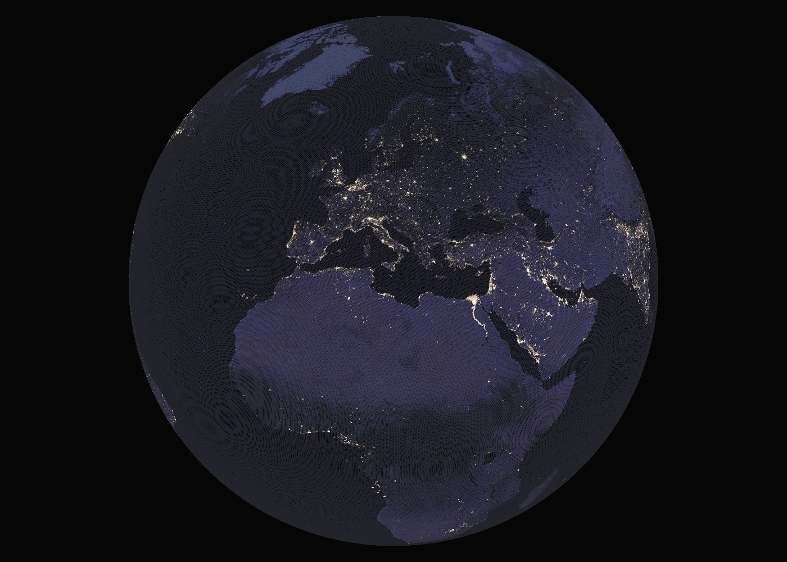

*the Earth at night over Europe and Africa, drawn from the Black Marble
city lights.*

```sh
grissom draw --earth-only --earth "$GRISSOM_DATA/earth" \
  --colourways "$GRISSOM_DATA/colourways" --earth-depth 9 --distance 4.2 \
  --no-hud --look 15,35 --earth-image 1 --shot out/night
```

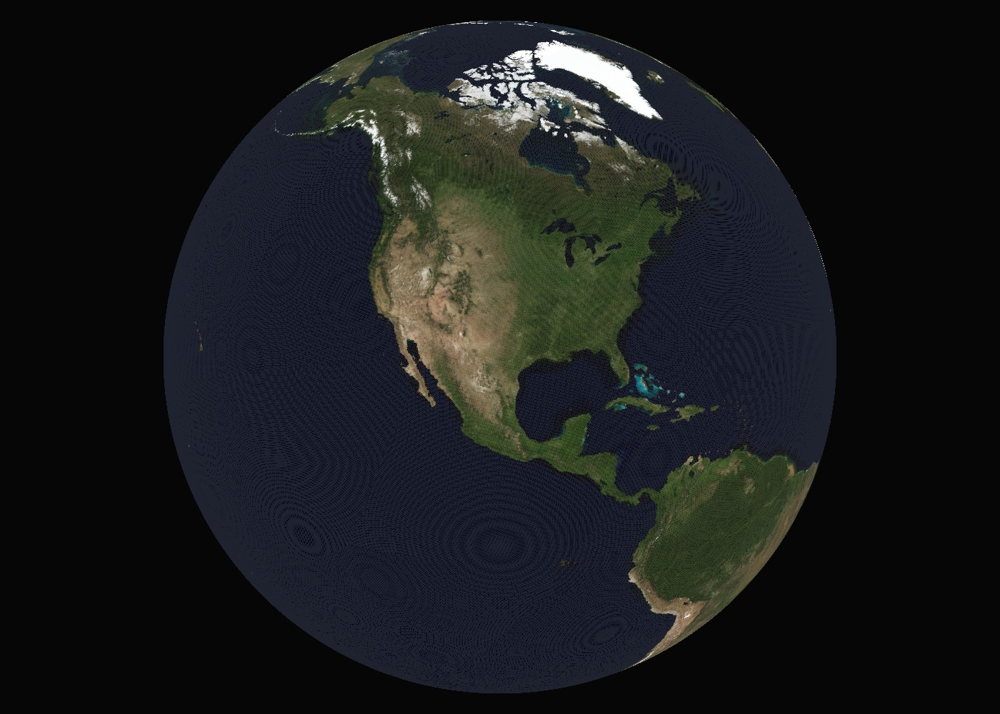

*the same Earth by day, centred on North America, from the Blue Marble
photograph.*

```sh
grissom draw --earth-only --earth "$GRISSOM_DATA/earth" \
  --colourways "$GRISSOM_DATA/colourways" --earth-depth 9 --distance 4.2 \
  --no-hud --look -100,30 --shot out/day
```

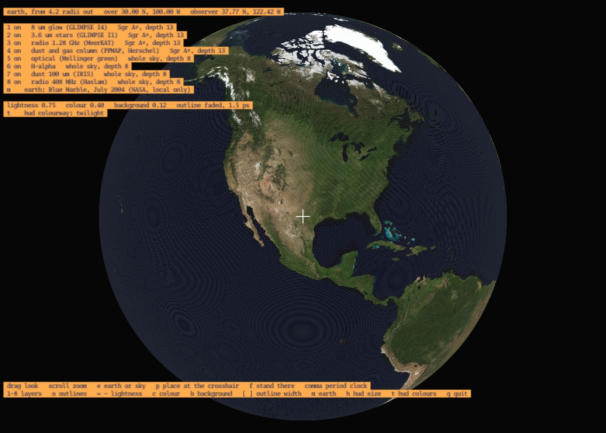

*Grissom's display: the layer list, the lightness, colour and background
settings, and the key help at the foot.*

```sh
grissom draw --data "$GRISSOM_DATA/sgra" --earth "$GRISSOM_DATA/earth" \
  --sky "$GRISSOM_DATA/sky" --colourways "$GRISSOM_DATA/colourways" \
  --earth-depth 9 --distance 4.2 --view 1 --shot out/shown
```

[](grissom-earth-turning.mp4)

*the Earth turning once, 60 frames at 20 a second (7 MB). select the
picture to download the film; GitHub doesn't play video in Markdown.*

```sh
mkdir -p out/film
grissom film --earth-only --earth "$GRISSOM_DATA/earth" \
  --colourways "$GRISSOM_DATA/colourways" --earth-depth 7 --distance 4.2 \
  --no-hud --frames 60 --turns 1 --tilt 25 --into out/film
```

the frames land in `out/film`; ffmpeg joins them into the mp4.

you fetch your own copy of the data (about 2 GiB) with
`game run grissom-data` before it shows anything.
[doc/grissom-setup.md](../grissom-setup.md) walks through the layout, the
fetch, and four links the viewer still needs for older file names.
`$GRISSOM_DATA` above is the data root that holds `sgra/`, `earth/`,
`sky/` and `colourways/`.

### build it

it needs cgo and the macOS frameworks. the ordinary root build makes it:

```sh
CGO_ENABLED=1 game build
```

that writes `bin/grissom`. the data comes through
[celestial-data](https://github.com/janearc/celestial-data), checked out
beside slayer; the setup doc has the sibling layout and the
`game run grissom-data` fetch.

### run it

three verbs: `window` opens the viewer, `draw` writes PNGs offscreen, `film`
draws the earth turning, frame by frame. flags are two dashes and whole
words. `grissom --help` lists them all. a first, small check, from the setup
doc:

```sh
mkdir -p out
game run grissom -- draw \
  --data "$GRISSOM_DATA/sgra" --earth "$GRISSOM_DATA/earth" \
  --sky "$GRISSOM_DATA/sky" --colourways "$GRISSOM_DATA/colourways" \
  --depth 7 --earth-depth 4 --wide-depth 4 \
  --shot "$PWD/out/check" --view -1
```

`--shot` is a prefix: this writes `out/check-sky.png`, `out/check-earth.png`
and `out/check-standing.png`. `--dry-run` lists them and writes nothing. the
same data flags with `window` open the viewer.

in the window, drag to turn and scroll to scale. `e` switches sky and earth,
`p` places an observer at the crosshair, `f` stands there, comma and period
move the clock an hour, `1` to `4` toggle the detail layers, `t` changes the
colourway, and `q` quits.

## where to go next

- [README](../../README.md): the map of everything.
- [getting started](../getting-started.md) and
  [building slayer](../building.md): the same ground as this page, kept
  current.
- [how slayer works](../../OPERATION.md): scenes, tracing, the darkroom,
  output, and the front door.
- [sets](../sets.md): what a set file says.
- [jobs](../../job/README.md): every job key, with print and stock.
- [camera motion](../camera-motion.md): moves, speeds and holds.
- [manufactory catalogue](../catalogue.md): the kinds slayer can make.
- [modes](../modes.md): careful measurement and fast films.
- [music](../music.md): scores, voicings and the tune library.
- [examples](../../EXAMPLES.md): more scenes and commands.
- [package guide](../../PACKAGES.md): what each Go package is for.
- [Ferruccio](../../ferruccio/README.md) and
  [running Grissom](../grissom-setup.md).

from [github.com/janearc/slayer](https://github.com/janearc/slayer).
